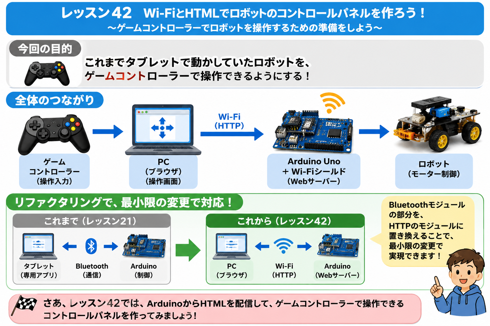
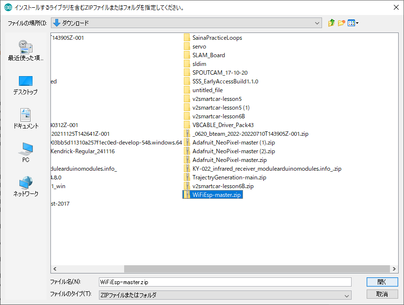

# レッスン42　Wi-FiとHTMLでロボットのコントロールパネルを作ろう！

## 今回の目的：ゲームコントローラーでロボットを動かすための準備

これまでタブレットの専用アプリで操作していたロボットを、**ゲームコントローラーで操作できるように改造**していきます。

完成したときのつながりは、次のようになります。

**ゲームコントローラー → PC（ブラウザ） → Wi-Fi・HTTP → Arduino Uno → ロボットのモーター**

ゲームコントローラーの操作はPCが受け取り、PCからロボットへ命令を送ります。ロボット側のArduinoは、その命令を受け取ってモーターを動かします。



> **今日のゴール**：ゲームコントローラーをつなぐ前に、ArduinoにWebサーバーを作り、PCのブラウザに表示したボタンでロボットを操作できるようにする。

### このレッスンで身につける力

- [ ] サーバーとクライアント、リクエストとレスポンスの意味を説明できる
- [ ] HTMLのリンクを使って、ブラウザからロボットに命令を送るしくみを説明できる
- [ ] 通信のモジュール（`bluetooth.h`）を、HTTPのモジュール（`http.h`）に取りかえられる
- [ ] 取りかえたときに出たエラーから、モジュールどうしのつながり（依存）に気づいて直せる
- [ ] PCのブラウザから、Wi-Fiでロボットを動かせる

---

## 1．なぜレッスン41でリファクタリングしたの？

レッスン41では、ひとつの大きなプログラムを、役割ごとの小さなまとまり（**モジュール**）に分けました。

その理由は、**今まで使っていた機能をできるだけ残し、変更が必要な部分だけを交換するため**です。

### これまでと、これからの違い


ここで置き換えるのは、主に**Bluetooth通信を担当していたプログラム**です。実際にはWi-Fiシールドを使うため、通信に使うハードウェアや初期設定も変更します。ただし、モーターの動かし方まで最初から書き直す必要はありません。

**考えてみよう：** もし通信処理とモーター制御がひとつの大きなコードに混ざっていたら、どんなことが大変になるでしょう？

## 2．サーバーとクライアント

Webサイトを見るとき、ブラウザはサーバーに「ページを見せてください」とお願いしています。

- **クライアント**：お願いする側。今回はPCのブラウザ。
- **サーバー**：お願いを受けて返事をする側。今回はArduino UnoとWi-Fiシールド。

今回は**Arduino自身がWebサーバー**になります。HTMLの操作画面もArduinoのプログラムに入れ、PCのブラウザに送ります。


## 3．HTTPのリクエストとレスポンス

**リクエスト**はクライアントからの要求、**レスポンス**はサーバーからの返事です。

### GETとPOST

| メソッド | 主な使い道 | 例 |
|---|---|---|
| `GET` | 情報やページを取得する | 操作画面を開く |
| `POST` | データを送ったり、処理を依頼したりする | フォームを送信する |

今回は仕組みを理解しやすくするため、**ロボットへの操作命令にもGETを使います**。一般的なWebサービスでは、状態を変える操作にGETを使うのは推奨されませんが、この授業では通信の流れを学ぶための簡単な例として扱います。

### リクエストの例

ブラウザで `http://192.168.1.20/forward` にアクセスすると、次のような要求が送られます（IPアドレスは例です）。

```http
GET /forward HTTP/1.1
Host: 192.168.1.20
```

| 書かれている部分 | 意味 |
|---|---|
| `GET` | リクエストの種類 |
| `/forward` | 前進という命令を表すパス |
| `HTTP/1.1` | HTTPのバージョン |
| `Host:` | 接続先のホスト |

Arduinoは `/forward` を読み取って、前進する処理を呼び出します。

### レスポンスの例

```http
HTTP/1.1 200 OK
Content-Type: text/html

<h1>Robot Controller</h1>
```

`200 OK` は要求が正常に処理されたことを表します。空行の後ろにHTMLなどの内容が続きます。

## 4．HTMLで操作画面を作ろう

HTMLは、ブラウザに表示する画面の内容を記述する言語です。

まずは次のような簡単なボタンを考えます。

```html
<!DOCTYPE html>
<html lang="ja">
<head>
  <meta charset="UTF-8">
  <title>Robot Controller</title>
</head>
<body>
  <h1>ロボット操作パネル</h1>
  <p><a href="/forward">▲ 前進</a></p>
  <p><a href="/left">◀ 左</a>
     <a href="/stop">■ 停止</a>
     <a href="/right">▶ 右</a></p>
  <p><a href="/back">▼ 後退</a></p>
</body>
</html>
```

`href="/forward"` は、ボタンを押すと `/forward` にアクセスする、という意味です。

**ポイント：** このHTMLはPCに置くのではなく、**Arduinoのプログラムから配信**します。Arduino Unoのメモリは小さいので、まずは短いHTMLから始めます。

## 5．bluetooth.h を http.h に取りかえよう

レッスン41で分けたプログラムのうち、**通信を担当している `bluetooth.h` だけ**を、HTTP通信を担当する `http.h` に取りかえます。

```text
1126taro/
├── 1126taro.ino    ← メインのファイル（通信に関係する行だけ書きかえる）
├── config.h        ← Wi-Fiの名前とパスワードを追加する
├── motor.h         ← そのまま使う
├── sound.h         ← そのまま使う
├── battle.h        ← ほぼそのまま使う（1行だけ直す。ミッション7）
├── hissatsu.h      ← そのまま使う
└── http.h          ← 今回追加する（bluetooth.h のかわり）
```

HTTP通信モジュール `http.h` には、主に次の役割を持たせます。

1. Wi-Fiに接続し、Webサーバーを起動する。
2. ブラウザからのHTTPリクエストを受け取る。
3. `/forward`、`/back`、`/left`、`/right`、`/stop` を読み取る。
4. すでにあるモーター制御の関数を呼び出す。
5. HTMLの操作画面や処理結果をレスポンスとして返す。

ここで大切なのは、**HTTP通信モジュールの中でモーターの細かい動かし方を作り直さないこと**です。レッスン41で整理した関数を呼び出します。

---

## ミッション1　今のプログラムを新しい名前で保存しよう

1. Arduino IDEで、レッスン41で整理したプログラムを開きます。
2. **ファイル → 名前を付けて保存**を選びます。
3. いつもと同じように、**日付4桁＋名前（英語）** で名前を付けます。例えば、11月26日にたろうさんが保存するなら `1126taro` です。

このテキストでは、例として `1126taro` という名前で説明します。`1126taro` と書いてあるところは、**自分のファイル名に読みかえて**ください。レッスン41と同じように、`1126taro` のタブのことを**メインのタブ**と呼びます。

- [ ] 新しい名前で保存できたらチェック！

---

## ミッション2　ロボットをWi-Fiで通信できるようにしよう

**安全のため、ここからはロボットの車輪を浮かせて（箱の上にのせるなどして）作業しましょう。**

レッスン18と同じように、Arduinoの上についているWi-Fiシールド（黒い基板）の赤いジャンパーキャップを、下の図の円で囲った部分と同じように付け替えます。


- [ ] ジャンパーキャップをWi-Fi用に付け替えられたらチェック！

---

## ミッション3　WiFiEspライブラリを準備しよう

Wi-Fiシールドを使うために、**WiFiEsp** ライブラリを使います。**レッスン18で入れた人は、このミッションはとばしてOK**です。

1. 下のリンクをクリックして、ライブラリのZIPファイルをダウンロードします。

   [WiFiEsp ライブラリをダウンロード](https://github.com/kobayashi-makoto2021/robobu/raw/main/v2/18_Wifi%E6%8E%A5%E7%B6%9A%E3%81%A7%E3%83%AD%E3%83%9C%E3%83%83%E3%83%88%E3%82%92%E5%8B%95%E3%81%8B%E3%81%9D%E3%81%86_%E5%AE%9F%E8%B7%B5/sample/WiFiEsp-master.zip)

2. Arduino IDEで、**スケッチ → ライブラリをインクルード → .ZIP形式のライブラリをインストール**を選びます。

   

3. ダウンロードした `WiFiEsp-master.zip` を選んで、**開く**を押します。

   

- [ ] WiFiEspライブラリを準備できたらチェック！

---

## ミッション4　`config.h` にWi-Fiの設定を追加しよう

ロボットを教室のWi-Fiにつなぐために、Wi-Fiの**名前（SSID）**と**パスワード**を `config.h` に書きます。名前とパスワードは、先生に教えてもらいましょう。

`config.h` のタブを開いて、いちばん下に次の3行を追加します。`"` と `"` のあいだを、教室のWi-Fiの名前とパスワードに書きかえます。

```cpp
// Wi-Fiの設定（教室のWi-Fiの名前とパスワードに書きかえる）
#define WIFI_SSID  "YOUR_ROUTER_SSID"
#define WIFI_PASS  "YOUR_ROUTER_WIFI_PASSWORD"
```

**注意：** Wi-Fiシールドは、**2.4GHz** のWi-Fiにしかつなげません。5GHz のWi-Fiの名前を書いても、つながりません。

- [ ] `config.h` にWi-Fiの設定を追加できたらチェック！

---

## ミッション5　`bluetooth.h` を `http.h` に取りかえよう

#### 手順1　`bluetooth.h` を削除する

1. `bluetooth.h` のタブを開きます。
2. タブが並んでいる行の右はしにある **「…」ボタン → 削除** を選びます。
3. 確認が出たら **OK** を押します。`bluetooth.h` のタブが消えたら成功です。

#### 手順2　新しいタブ `http.h` を作る

レッスン41と同じように、**「…」ボタン → 新規タブ**で、`http.h` という名前のタブを作ります。

#### 手順3　`http.h` にプログラムを書く

`http.h` のタブに、次のプログラムを**全部コピーして貼り付け**ます（コードの右上のボタンでコピーできます）。

```cpp
// =============================================
//  http.h  Wi-Fi・HTTP通信
//  ブラウザから届いた命令（リクエスト）を読んで、ロボットを動かす。
//  ほかの .h の関数を全部呼ぶので、いちばん最後に読み込む。
// =============================================
#pragma once

WiFiEspServer server(80);  // 80番の入口で、ブラウザからのリクエストを待つ

// ---- Wi-Fiにつないで、Webサーバーを始める（setup() で1回だけ呼ぶ）----
void http_init()
{
  // Wi-Fiシールドとの通信の準備（レッスン18と同じ）
  espSerial.begin(115200);
  espSerial.print("AT+CIOBAUD=9600\r\n");
  espSerial.write("AT+RST\r\n");
  espSerial.begin(9600);
  WiFi.init(&espSerial);

  if (WiFi.status() == WL_NO_SHIELD) {
    Serial.println("Wi-Fiシールドが見つかりません");
    while (true);  // ここで止まる
  }

  // 教室のWi-Fiにつながるまで、くり返す
  while (WiFi.status() != WL_CONNECTED) {
    Serial.print("Wi-Fiに接続中: ");
    Serial.println(WIFI_SSID);
    WiFi.begin(WIFI_SSID, WIFI_PASS);
  }

  server.begin();  // Webサーバーを始める
  Serial.print("ブラウザで開くアドレス → http://");
  Serial.println(WiFi.localIP());
}

// ---- レスポンス（返事）として、操作画面のHTMLを送る ----
void sendPage(WiFiEspClient &client)
{
  // 1. ヘッダー：「うまくいったよ（200 OK）。中身はHTMLだよ」
  client.print(F(
    "HTTP/1.1 200 OK\r\n"
    "Content-Type: text/html; charset=UTF-8\r\n"
    "Connection: close\r\n"
    "\r\n"));
  // 2. 本体：操作画面のHTML
  client.print(F(
    "<!DOCTYPE html>"
    "<html lang=\"ja\">"
    "<head><meta charset=\"UTF-8\"><title>Robot Controller</title></head>"
    "<body>"
    "<h1>ロボット操作パネル</h1>"
    "<p><a href=\"/forward\">▲ 前進</a></p>"
    "<p><a href=\"/left\">◀ 左</a> "
    "<a href=\"/stop\">■ 停止</a> "
    "<a href=\"/right\">▶ 右</a></p>"
    "<p><a href=\"/back\">▼ 後退</a></p>"
    "</body></html>"));
}

// ---- リクエストの1行目から、パス（/forward など）を取り出す ----
// 例：「GET /forward HTTP/1.1」→「/forward」
String getPath(String request)
{
  int space1 = request.indexOf(' ');               // 1つ目のスペース
  int space2 = request.indexOf(' ', space1 + 1);   // 2つ目のスペース
  return request.substring(space1 + 1, space2);    // そのあいだがパス
}

// ---- パスに合わせて、ロボットを動かす ----
// モーターの動かし方は motor.h の関数を呼ぶだけ。ここでは作り直さない。
void doCommand(String path)
{
  if      (path == "/forward") go_Advance();
  else if (path == "/back")    go_Back();
  else if (path == "/left")    go_Left();
  else if (path == "/right")   go_Right();
  else if (path == "/stop")    stop_Stop();
}

// ---- ブラウザからリクエストが来ていたら受け取って、返事をする（loop() で毎回呼ぶ）----
void do_Http_Tick()
{
  WiFiEspClient client = server.available();  // ブラウザが来ているか見る
  if (!client) return;                         // 来ていなければ何もしない

  String request = "";      // リクエストの1行目（例：GET /forward HTTP/1.1）
  bool firstLine = true;    // 今、1行目を読んでいるか
  bool lineIsBlank = true;  // 今の行が、まだ空っぽか

  while (client.connected()) {
    if (client.available()) {
      char c = client.read();

      // 1行目だけを request にためる
      if (firstLine && c != '\r' && c != '\n' && request.length() < 40) {
        request += c;
      }

      // 空っぽの行が来たら、リクエストはおしまい → 命令を実行して返事をする
      if (c == '\n' && lineIsBlank) {
        Serial.println(request);
        doCommand(getPath(request));
        sendPage(client);
        break;
      }

      if (c == '\n') {
        firstLine = false;   // 2行目からは読み飛ばす
        lineIsBlank = true;
      } else if (c != '\r') {
        lineIsBlank = false;
      }
    }
  }
  delay(10);       // ブラウザが受け取るのを少し待つ
  client.stop();   // 通信を終わる
}
```

#### `http.h` の中身を見てみよう

5章で考えた役割が、それぞれどの関数になっているか確かめましょう。

| 関数 | 役割 |
|---|---|
| `http_init()` | ① Wi-Fiに接続し、Webサーバーを起動する |
| `do_Http_Tick()` | ② ブラウザからのリクエストを受け取る |
| `getPath()` | ③ リクエストの1行目から `/forward` などのパスを取り出す |
| `doCommand()` | ④ パスに合わせて、`go_Advance()` などのモーターの関数を呼び出す |
| `sendPage()` | ⑤ 操作画面のHTMLをレスポンスとして返す |

`sendPage()` の中に、4章のHTMLが入っています。`F("...")` で囲むと、HTMLを小さなRAMではなく、大きなフラッシュメモリのほうに入れておけます。HTMLの中の `"` は、`\"` と書きます（`"` だけだと、文字列の終わりとまちがえられてしまうからです）。

- [ ] `bluetooth.h` を削除できたらチェック！
- [ ] `http.h` を作れたらチェック！

---

## ミッション6　メインのタブを書きかえよう

メインのタブで、**通信に関係する6か所だけ**を書きかえます。それ以外の行は、そのままにしておきます。

#### 書きかえ1　WiFiEspライブラリを読み込む

`#include <IRremote.h>` のすぐ下に1行追加します。

```cpp
#include <IRremote.h>
#include <WiFiEsp.h>         // ← この行を追加する
#include "config.h"
```

#### 書きかえ2　`BTSerial` を `espSerial` にする

D4・D5ピンの通信の相手が、Bluetoothモジュールから**Wi-Fiシールド（ESP8266）**にかわります。名前も分かりやすく変えましょう。

```cpp
SoftwareSerial BTSerial(4, 5);  //RX,TX      ← 書きかえる前
SoftwareSerial espSerial(4, 5);  //RX,TX     ← 書きかえた後
```

#### 書きかえ3　Bluetooth専用の変数を消す

次の3行は、`bluetooth.h` だけが使っていた変数です。もう使わないので消します。

```cpp
char buffUART[MAX_PACKETSIZE];      // ← 消す
unsigned int buffUARTIndex = 0;     // ← 消す
unsigned long preUARTTick = 0;      // ← 消す
```

#### 書きかえ4　`#include "bluetooth.h"` を `#include "http.h"` にする

```cpp
#include "motor.h"
#include "sound.h"
#include "battle.h"
#include "hissatsu.h"    // 必殺技を作った人だけ
#include "http.h"        // ← bluetooth.h から書きかえる
```

`http.h` も、ほかの全部の関数を使うので、いちばん最後に読み込みます。

#### 書きかえ5　`setup()` の中

```cpp
  BTSerial.begin(9600);     // ← 書きかえる前
  http_init();              // ← 書きかえた後：Wi-Fiにつないで、Webサーバーを始める
```

#### 書きかえ6　`loop()` の中

```cpp
  do_Uart_Tick();           // ← 書きかえる前
  do_Http_Tick();           // ← 書きかえた後：ブラウザからの命令を見る
```

- [ ] 6か所を書きかえられたらチェック！

---

## ミッション7　検証して、エラーを直そう

**検証（チェックマーク）**を押してみましょう。すると、次のようなエラーが出るはずです。

```text
battle.h:〇:〇: error: 'BTSerial' was not declared in this scope
```

「`battle.h` の中で `BTSerial` を使おうとしたけれど、見つからないよ」という意味です。

`battle.h` のタブを開いて、`deadAlarm()` を見てみましょう。

```cpp
void deadAlarm(){
  BTSerial.println("DEAD!");   // ← Bluetoothでアプリに「やられた」と知らせていた行
  Serial.println("DEAD!");
  stop_Stop();
  ...
```

1行目は、弾に当たったことを**Bluetoothでタブレットのアプリに知らせる**ための行でした。今回はアプリを使わないので、この行は必要ありません。**この1行を消して**、もう一度検証しましょう。エラーが出なければ成功です。

> **ふりかえり：** `battle.h` は「対戦の処理」のモジュールのはずなのに、中で Bluetooth を使っていました。このように、あるモジュールがほかのものに頼っていることを**依存**といいます。通信を取りかえたら、依存していたところでエラーが出ました。モジュールが、ほかのモジュールにできるだけ頼らないように作っておくと、取りかえがもっと楽になります。

- [ ] `BTSerial` の行を消して、エラーなく検証できたらチェック！

---

## ミッション8　書き込んで、IPアドレスを確かめよう

1. ロボットとPCをUSBケーブルでつなぎ、**書き込み（→ボタン）**を押します。
2. 書き込みが終わったら、右上の**シリアルモニター（虫めがねのボタン）**を開き、シリアルモニターの右側にある速さの設定を **9600 baud** にします。
3. しばらく待つと、次のように表示されます（つながるまで、数十秒かかることがあります）。

```text
Wi-Fiに接続中: （教室のWi-Fiの名前）
ブラウザで開くアドレス → http://192.168.〇.〇
```

`http://` から後ろが、ロボットの住所（**IPアドレス**）です。メモしておきましょう。

**うまくいかないときは：**

| 表示 | 確かめること |
|---|---|
| `Wi-Fiシールドが見つかりません` | ジャンパーキャップの付け方（ミッション2） |
| `Wi-Fiに接続中` がずっとくり返される | Wi-Fiの名前とパスワードのまちがい、2.4GHz のWi-Fiかどうか（ミッション4） |
| 何も表示されない | シリアルモニターの速さが 9600 baud になっているか |

- [ ] ロボットのIPアドレスを確認できたらチェック！

---

## ミッション9　ブラウザからロボットを動かそう

1. PCが、ロボットと**同じWi-Fi**につながっていることを確かめます。
2. PCのブラウザを開いて、アドレスバーにミッション8でメモしたアドレス（例：`http://192.168.1.20`）を入力します。
3. 「ロボット操作パネル」が表示されたら成功です。
4. **▲ 前進**、**◀ 左**、**▶ 右**、**▼ 後退**、**■ 停止**を押して、ロボットが動くか確かめましょう。

ボタンを押すたびに、シリアルモニターに `GET /forward HTTP/1.1` のようなリクエストが表示されます。3章で学んだリクエストが、本当に届いていることを見てみましょう。

**注意：** ロボットは、次のボタンを押すまで同じ動きを続けます。止めたいときは **■ 停止** を押しましょう。

---

## 動作を確認しよう

- [ ] ArduinoがWi-Fiに接続できた。
- [ ] ArduinoのIPアドレスを確認できた。
- [ ] PCのブラウザからArduinoのIPアドレスにアクセスできた。
- [ ] Arduinoが配信するHTMLの操作画面が表示された。
- [ ] 前進・後退・左・右・停止の命令を送れた。
- [ ] 既存のモーター制御を再利用してロボットが動いた。
- [ ] 通信処理とモーター制御が別のモジュールになっていることを説明できた。

**安全確認：** ロボットを机から落とさないように、最初は車輪を浮かせて動作を確認します。今回のプログラムは、**停止の命令が届くまで動き続けます**。Wi-Fiが切れて止められなくなったときは、ロボットの電源スイッチを切りましょう。

### どうしてもうまくいかないときは

完成例のサンプルコードと見比べてみましょう。

[ここをクリックして完成例をダウンロード](https://github.com/kobayashi-makoto2021/robobu/raw/main/Lesson_42/sample/lesson_42_sample.zip)

完成例はレッスン41の完成例をもとにしているので、自分で追加した必殺技などは入っていません。書き込む前に、`config.h` のWi-Fiの名前とパスワードを書きかえましょう。

---

## ミッションチャレンジ　操作パネルにボタンを増やそう

#### チャレンジ1　「撃つ」ボタンを追加しよう

`http.h` を2か所書きかえると、ブラウザから赤外線の弾を撃てるようになります。

**① `sendPage()` のHTMLに、ボタンを1行追加する**

```cpp
    "<p><a href=\"/back\">▼ 後退</a></p>"
    "<p><a href=\"/shoot\">● 撃つ</a></p>"      // ← この行を追加する
    "</body></html>"));
```

**② `doCommand()` に、`/shoot` のときの動きを追加する**

```cpp
  else if (path == "/stop")    stop_Stop();
  else if (path == "/shoot")   { buttonState=1; shoot(); }   // ← この行を追加する
```

`buttonState=1;shoot();` は、レッスン21・22でアプリのF1ボタンに割り当てていたものと同じです。

#### チャレンジ2　必殺技のボタンを追加しよう

チャレンジ1と同じやり方で、`hissatsu.h` に入れた必殺技を呼び出すボタンを作ってみましょう。パスの名前（`/hissatsu` など）とボタンの文字は、自分で決めてOKです。

---

## まとめ

今回の改造では、レッスン41でプログラムを整理したおかげで、**通信の仕組みをBluetoothからWi-Fi・HTTPへ変更しながら、モーター制御などの既存の機能を再利用**できました。

また、ArduinoがWebサーバーとなり、PCのブラウザからHTTPリクエストを送ってロボットを動かす仕組みを学びました。

- **サーバー**：お願いを受けて返事をする側（今回はArduino）
- **クライアント**：お願いする側（今回はPCのブラウザ）
- **リクエスト**：クライアントからの要求（例：`GET /forward HTTP/1.1`）
- **レスポンス**：サーバーからの返事（例：`HTTP/1.1 200 OK` とHTML）
- **パス**：リクエストの中の `/forward` のような部分。今回はロボットへの命令として使った
- **IPアドレス**：ネットワークの中での住所（例：`192.168.1.20`）
- **依存**：あるモジュールが、ほかのものに頼っていること

### 出来たことをチェックしよう

- [ ] サーバーとクライアント、リクエストとレスポンスの意味を説明できる
- [ ] HTMLのリンクを使って、ブラウザからロボットに命令を送るしくみを説明できる
- [ ] 通信のモジュール（`bluetooth.h`）を、HTTPのモジュール（`http.h`）に取りかえられる
- [ ] 取りかえたときに出たエラーから、モジュールどうしのつながり（依存）に気づいて直せる
- [ ] PCのブラウザから、Wi-Fiでロボットを動かせる

### 次のステップ

次はPCにつないだ**ゲームコントローラーのボタンやスティックの操作**を読み取り、今回作ったHTTP通信の仕組みを使ってロボットへ伝えます。

**ゲームコントローラー → PC → Wi-Fi・HTTP → Arduino → ロボット**

このつながりを完成させましょう！

---

*講師向けメモ：Wi-FiはSTAモード（教室のルーター経由）で接続します。ESP8266 は 2.4GHz 帯のみ対応です。ゲスト用Wi-Fiなどで端末間通信が禁止（クライアント分離）されていると、PCからロボットに届きません。Wi-Fiの名前とパスワードは生徒のプログラムに書かれるので、生徒に伝えてよいネットワークを使ってください。Wi-Fiシールドの初期化はレッスン18と同じ手順（115200bpsで `AT+CIOBAUD=9600` を送ってから9600bpsで通信）です。完成例 `sample/lesson_42_sample` は、WiFiEsp 2.2.2・IRremote 2.2.3 で Arduino Uno 向けにコンパイルでき、フラッシュ68%・RAM48%（グローバル変数987バイト）を使います。また、レッスン41のテキストどおりに分割したプログラムに、このテキストの手順（ミッション4〜7）を当てはめると、ミッション7で `'BTSerial' was not declared in this scope` が出て、1行消すとコンパイルできることを確認済みです。弾に当たると `deadAlarm()` の無限ループに入るため、それ以降はブラウザからの操作にも反応しなくなります（レッスン21と同じルール）。*
