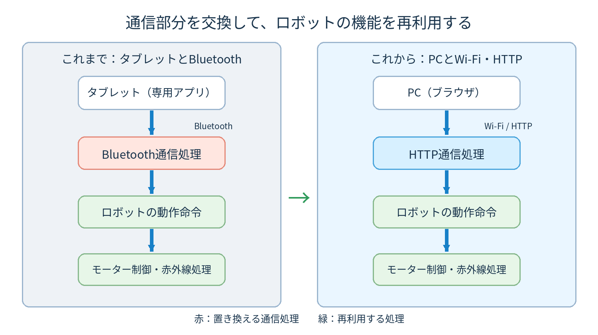
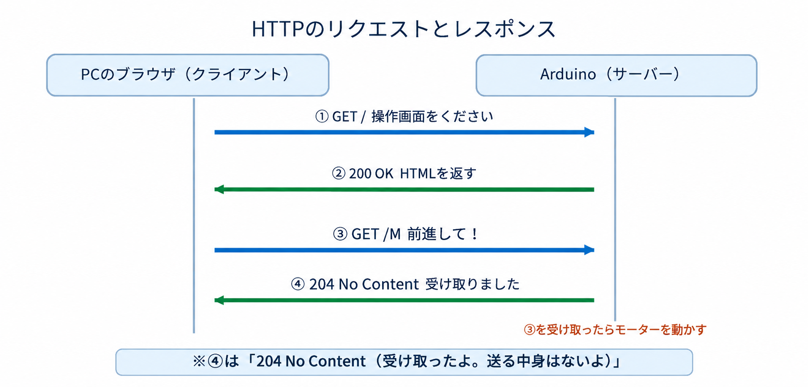
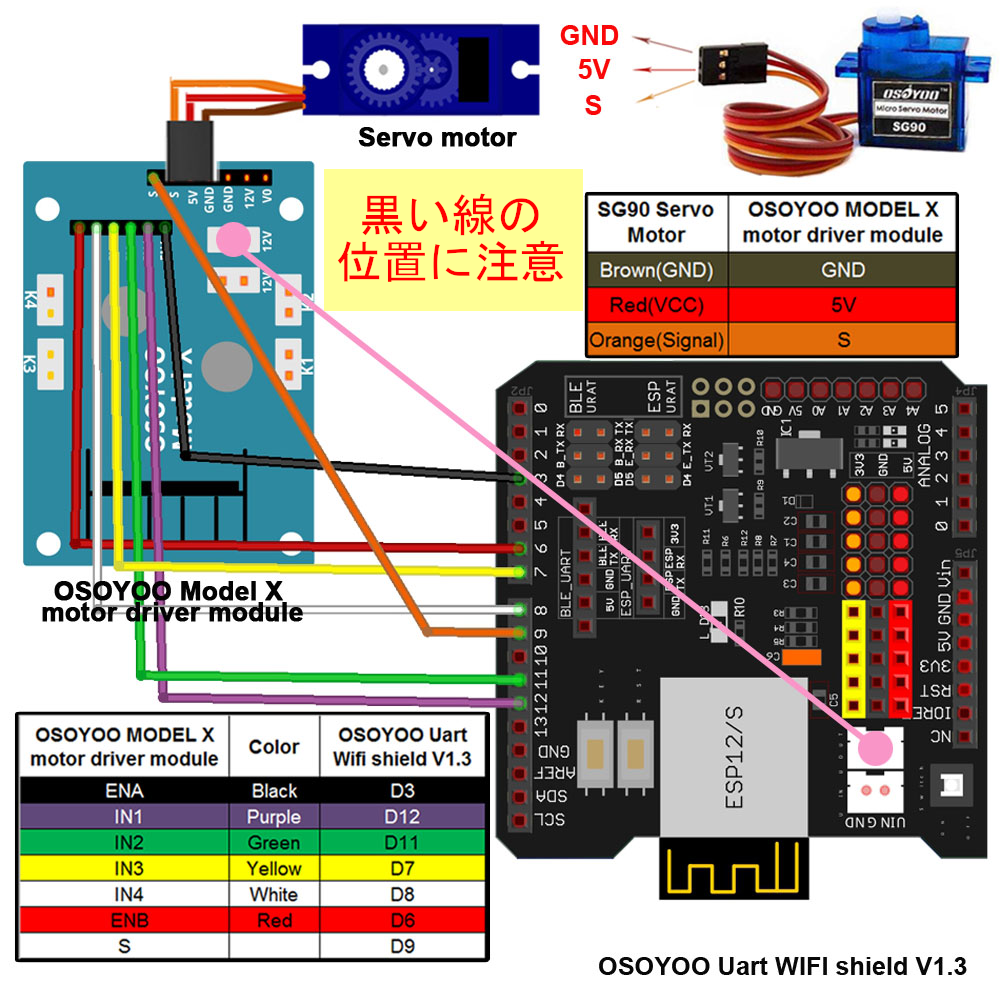
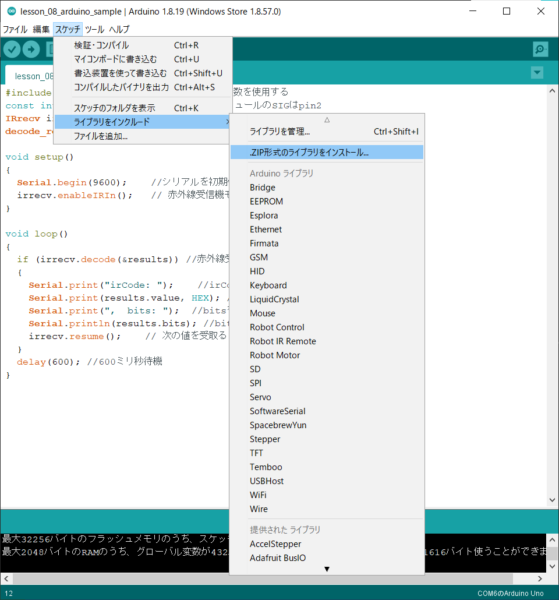

# レッスン42　Wi-FiとHTMLでロボットのコントロールパネルを作ろう！

## 今回の目的：ゲームコントローラーでロボットを動かすための準備

これまでタブレットの専用アプリで操作していたロボットを、**ゲームコントローラーで操作できるように改造**していきます。

完成したときのつながりは、次のようになります。

**ゲームコントローラー → PC（ブラウザ） → Wi-Fi・HTTP → Arduino Uno → ロボットのモーター**

ゲームコントローラーの操作はPCが受け取り、PCからロボットへ命令を送ります。ロボット側のArduinoは、その命令を受け取ってモーターを動かします。


> **今日のゴール**：ゲームコントローラーをつなぐ前に、ArduinoにWebサーバーを作り、PCのブラウザに表示したボタンでロボットを操作できるようにする。

### このレッスンで身につける力

- [ ] サーバーとクライアント、リクエストとレスポンスの意味を説明できる
- [ ] HTMLのリンクを使って、ブラウザからロボットに命令を送るしくみを説明できる
- [ ] 通信のモジュール（`bluetooth.h`）を、HTTPのモジュール（`http.h`）に取りかえられる
- [ ] 取りかえたときに出たエラーから、モジュールどうしのつながり（依存）に気づいて直せる
- [ ] PCのブラウザから、Wi-Fiでロボットを動かせる

---

## 1．なぜレッスン41でリファクタリングしたの？

レッスン41では、ひとつの大きなプログラムを、役割ごとの小さなまとまり（**モジュール**）に分けました。

その理由は、**今まで使っていた機能をできるだけ残し、変更が必要な部分だけを交換するため**です。

### これまでと、これからの違い



ここで置き換えるのは、主に**Bluetooth通信を担当していたプログラム**です。実際にはWi-Fiシールドを使うため、通信に使うハードウェアや初期設定も変更します。ただし、モーターの動かし方まで最初から書き直す必要はありません。

**考えてみよう：** もし通信処理とモーター制御がひとつの大きなコードに混ざっていたら、どんなことが大変になるでしょう？

## 2．サーバーとクライアント

Webサイトを見るとき、ブラウザはサーバーに「ページを見せてください」とお願いしています。

- **クライアント**：お願いする側。今回はPCのブラウザ。
- **サーバー**：お願いを受けて返事をする側。今回はArduino UnoとWi-Fiシールド。

今回は**Arduino自身がWebサーバー**になります。HTMLの操作画面もArduinoのプログラムに入れ、PCのブラウザに送ります。



## 3．HTTPのリクエストとレスポンス

**リクエスト**はクライアントからの要求、**レスポンス**はサーバーからの返事です。

### GETとPOST

| メソッド | 主な使い道 | 例 |
|---|---|---|
| `GET` | 情報やページを取得する | 操作画面を開く |
| `POST` | データを送ったり、処理を依頼したりする | フォームを送信する |

今回は仕組みを理解しやすくするため、**ロボットへの操作命令にもGETを使います**。一般的なWebサービスでは、状態を変える操作にGETを使うのは推奨されませんが、この授業では通信の流れを学ぶための簡単な例として扱います。

### リクエストの例

ブラウザで `http://192.168.1.20/M` にアクセスすると、次のような要求が送られます（IPアドレスは例です）。

```http
GET /M HTTP/1.1
Host: 192.168.1.20
```

| 書かれている部分 | 意味 |
|---|---|
| `GET` | リクエストの種類 |
| `/M` | 前進という命令を表すパス（Mは、タブレットのアプリで前進に使っていた文字） |
| `HTTP/1.1` | HTTPのバージョン |
| `Host:` | 接続先のホスト |

Arduinoは `/M` の `M` を読み取って、前進する処理を呼び出します。命令の文字は、**タブレットのアプリと同じ**にしています（`M`：前進、`B`：後退、`L`：左、`R`：右、`E`：停止）。

### レスポンスの例

```http
HTTP/1.1 200 OK
Content-Type: text/html

<h1>Robot Controller</h1>
```

`200 OK` は要求が正常に処理されたことを表します。空行の後ろにHTMLなどの内容が続きます。

ロボットへの命令（`/M` など）には、次のような短いレスポンスを返します。

```http
HTTP/1.1 204 No Content
```

`204 No Content` は「受け取ったよ。でも送る中身はないよ」という意味です。このレスポンスを受け取ったブラウザは、今の画面をそのまま表示し続けます。命令のたびに操作画面を送り直さないので、そのぶん早く次の命令を受け取れます。

## 4．HTMLで操作画面を作ろう

HTMLは、ブラウザに表示する画面の内容を記述する言語です。

まずは次のような簡単なボタンを考えます。

```html
<!DOCTYPE html>
<html lang="ja">
<head>
  <meta charset="UTF-8">
  <title>Robot Controller</title>
</head>
<body>
  <h1>ロボット操作パネル</h1>
  <p><a href="/M">▲ 前進</a></p>
  <p><a href="/L">◀ 左</a>
     <a href="/E">■ 停止</a>
     <a href="/R">▶ 右</a></p>
  <p><a href="/B">▼ 後退</a></p>
</body>
</html>
```

`href="/M"` は、ボタンを押すと `/M` にアクセスする、という意味です。

### HTMLの読み方

HTMLは、**タグ**という「しるし」で、画面の部品をはさんで書きます。

```html
<h1>ロボット操作パネル</h1>
```

- `<h1>` が**はじまりのタグ**、`</h1>` が**おわりのタグ**です。おわりのタグには `/` がつきます。
- はじまりとおわりのあいだにある「ロボット操作パネル」が、画面に表示される文字です。
- `h1` は「大きな見出し」という意味です。だから、この文字は大きく太く表示されます。

上のHTMLに出てくるタグの意味は、次のとおりです。

| タグ | 意味 |
|---|---|
| `<!DOCTYPE html>` | 「これはHTMLで書いたページです」というあいさつ。いちばん最初に1回だけ書く |
| `<html>` 〜 `</html>` | ページ全体。ほかのタグは、全部この中に入る |
| `<head>` 〜 `</head>` | ページの**設定**を書くところ。ここに書いたものは、画面の中には表示されない |
| `<meta charset="UTF-8">` | 「文字は UTF-8 という方式で書いてあります」という設定。これがないと日本語が文字化けすることがある |
| `<title>` 〜 `</title>` | ブラウザのタブに出る名前 |
| `<body>` 〜 `</body>` | 画面に**表示される中身**を書くところ |
| `<h1>` 〜 `</h1>` | 大きな見出し |
| `<p>` 〜 `</p>` | 1つのまとまった文（段落）。`<p>` ごとに行がかわる |
| `<a href="/M">` 〜 `</a>` | **リンク**。はさんだ文字をクリックすると、`href` に書いた場所（ここでは `/M`）にアクセスする |

`<a href="/M">` の `href="/M"` のように、タグの中に `名前="値"` の形で書く追加の情報を**属性**といいます。`<html lang="ja">` の `lang="ja"` も属性で、「このページは日本語です」という意味です。

**考えてみよう：** 「▲ 前進」のリンクを押すと、ブラウザはロボットに何というリクエストを送るでしょう？（ヒント：3章の `GET` を思い出そう）

**ポイント：** このHTMLはPCに置くのではなく、**Arduinoのプログラムから配信**します。Arduino Unoのメモリは小さいので、まずは短いHTMLから始めます。

実際に使う操作パネル（ミッション5の `page.h`）では、この形をもとに、次の2つを足しています。

- **CSS**：ボタンを大きな四角にして、ゲーム機の十字キーのようにならべる「見た目の設定」
- **スライダー**：ボタンを1回押したときに動く時間を、画面から変えられるようにする

## 5．bluetooth.h を http.h に取りかえよう

レッスン41で分けたプログラムのうち、**通信を担当している `bluetooth.h` だけ**を、HTTP通信を担当する `http.h` に取りかえます。

ここでいう「取りかえる」とは、**メインのタブが使う通信のファイルを、`bluetooth.h` から `http.h` に切りかえる**ことです。`.h` ファイルは、タブにあるだけでは使われません。メインのタブで `#include` して、その中の関数を呼び出したときに、はじめて使われます。そのため、`http.h` を作るだけでなく、メインのタブも書きかえます（ミッション6）。

`bluetooth.h` は消さずに残しておきます。`#include` しなければ使われないので、残っていてもじゃまになりません。

```text
1126taro/
├── 1126taro.ino    ← メインのファイル（通信に関係する行だけ書きかえる）
├── config.h        ← Wi-Fiの名前とパスワードを追加する
├── motor.h         ← そのまま使う
├── sound.h         ← そのまま使う
├── battle.h        ← ほぼそのまま使う（1行だけ直す。ミッション7）
├── hissatsu.h      ← そのまま使う
├── bluetooth.h     ← 残しておく（今回は #include しないので使われない）
├── page.h          ← 今回追加する（操作画面のHTML）
└── http.h          ← 今回追加する（bluetooth.h のかわりに使う）
```

HTTP通信モジュール `http.h` には、主に次の役割を持たせます。

1. Wi-Fiに接続し、Webサーバーを起動する。
2. ブラウザからのHTTPリクエストを受け取る。
3. `/M`、`/B`、`/L`、`/R`、`/E` の命令の1文字を読み取る。
4. `bluetooth.h` と同じ switch 文で、すでにあるモーター制御の関数を呼び出す。
5. HTMLの操作画面や処理結果をレスポンスとして返す。
6. 安全のため、命令を受け取ってから0.5秒たったらロボットを止める。
7. 止まるまでの時間を、画面のスライダーで変えられるようにする。

ここで大切なのは、**HTTP通信モジュールの中でモーターの細かい動かし方を作り直さないこと**です。レッスン41で整理した関数を呼び出します。

`http.h` のプログラムは、ミッション5に**全部のせてあります**。自分で一から書く必要はありません。

---

## ミッション1　今のプログラムを新しい名前で保存しよう

1. Arduino IDEで、レッスン41で整理したプログラムを開きます。
2. **ファイル → 名前を付けて保存**を選びます。
3. いつもと同じように、**日付4桁＋名前（英語）** で名前を付けます。例えば、11月26日にたろうさんが保存するなら `1126taro` です。

このテキストでは、例として `1126taro` という名前で説明します。`1126taro` と書いてあるところは、**自分のファイル名に読みかえて**ください。レッスン41と同じように、`1126taro` のタブのことを**メインのタブ**と呼びます。

- [ ] 新しい名前で保存できたらチェック！

---

## ミッション2　ロボットをWi-Fiで通信できるようにしよう

**安全のため、ここからはロボットの車輪を浮かせて（箱の上にのせるなどして）作業しましょう。**

1. Bluetoothモジュール **HC-02（緑色の小さな基板）** は、もう使わないので**外してOK**です。なくさないように、しまっておきましょう。
2. Wi-Fiシールド（Arduinoの上についている黒い基板）の赤いジャンパーキャップは、**そのままで大丈夫**です。

ミッション8で「`Wi-Fiシールドが見つかりません`」と表示されたときは、ジャンパーキャップが下の図の円で囲った部分と同じになっているか、確かめましょう（レッスン18と同じ付け方です）。




- [ ] HC-02を外せたらチェック！

---

## ミッション3　WiFiEspライブラリを準備しよう

Wi-Fiシールドを使うために、**WiFiEsp** ライブラリを使います。**レッスン18で入れた人は、このミッションはとばしてOK**です。

1. 下のリンクをクリックして、ライブラリのZIPファイルをダウンロードします。

   [WiFiEsp ライブラリをダウンロード](https://github.com/kobayashi-makoto2021/robobu/raw/main/v2/18_Wifi%E6%8E%A5%E7%B6%9A%E3%81%A7%E3%83%AD%E3%83%9C%E3%83%83%E3%83%88%E3%82%92%E5%8B%95%E3%81%8B%E3%81%9D%E3%81%86_%E5%AE%9F%E8%B7%B5/sample/WiFiEsp-master.zip)

2. Arduino IDEで、**スケッチ → ライブラリをインクルード → .ZIP形式のライブラリをインストール**を選びます。

   

3. ダウンロードした `WiFiEsp-master.zip` を選んで、**開く**を押します。

   

- [ ] WiFiEspライブラリを準備できたらチェック！

---

## ミッション4　`config.h` にWi-Fiの設定を追加しよう

ロボットを教室のWi-Fiにつなぐために、Wi-Fiの**名前（SSID）**と**パスワード**を `config.h` に書きます。名前とパスワードは、先生に教えてもらいましょう。

`config.h` のタブを開いて、いちばん下に次の行を追加します。`"` と `"` のあいだを、教室のWi-Fiの名前とパスワードに書きかえます。

```cpp
// Wi-Fiの設定（教室のWi-Fiの名前とパスワードに書きかえる）
#define WIFI_SSID  "YOUR_ROUTER_SSID"
#define WIFI_PASS  "YOUR_ROUTER_WIFI_PASSWORD"
```

**注意：** Wi-Fiシールドは、**2.4GHz** のWi-Fiにしかつなげません。5GHz のWi-Fiの名前を書いても、つながりません。

- [ ] `config.h` にWi-Fiの設定を追加できたらチェック！

---

## ミッション5　`page.h` と `http.h` を作ろう

今回は、新しいファイルを2つ作ります。

| ファイル | 中身 |
|---|---|
| `page.h` | 操作画面のHTML（ブラウザに表示する画面） |
| `http.h` | Wi-Fi・HTTPの通信（リクエストを受け取って、ロボットを動かし、返事をする） |

画面のデザインと通信の処理を、別々のファイルに分けておきます。こうすると、画面を変えたいときは `page.h` だけを見ればよくなります（レッスン41のモジュール化と同じ考え方です）。

`bluetooth.h` のタブは、消さずにそのまま残しておきます。

どちらのファイルも、書くのは**下の灰色のわくの中のプログラム全部**です。自分で書き足したり、書きかえたりする必要はありません。わくの右上にある**コピーボタン**を押すと、わくの中を全部コピーできます。

#### 手順1　新しいタブ `page.h` を作って、HTMLを貼り付ける

1. レッスン41と同じように、**「…」ボタン → 新規タブ**で、`page.h` という名前のタブを作ります。
2. 下のわくの中を全部コピーして、`page.h` のタブに**貼り付け**（`Ctrl` + `V`）ます。
3. `page.h` の1行目が `// =====...` で始まり、最後の行が `)=====";` で終わっていれば成功です。

```cpp
// =============================================
//  page.h  操作画面のHTML
//  R"=====( と )=====" のあいだには、ふつうのHTMLをそのまま書ける。
//  PROGMEM：小さなRAMではなく、大きなフラッシュメモリに入れておく
//
//  スライダーのはじめの値（moveTime）を、PAGE_TOP と PAGE_BOTTOM の
//  あいだに http.h が書きこむ。そのため2つに分けている。
// =============================================
#pragma once

// ---- 前半：見た目の設定（CSS）、ボタン、スライダーの途中まで ----
const char PAGE_TOP[] PROGMEM = R"=====(<!DOCTYPE html>
<html lang="ja">
<head>
<meta charset="UTF-8">
<title>Robot Controller</title>
<link rel="icon" href="data:,">
<style>
body { font-family: sans-serif; text-align: center; background: #eef3f8; color: #1f2d3d; }
.pad { display: grid; grid-template-columns: repeat(3, 90px); grid-template-rows: repeat(3, 90px);
       gap: 10px; justify-content: center; margin: 20px auto; }
.btn { display: flex; align-items: center; justify-content: center; min-width: 90px; height: 90px;
       padding: 0 16px; box-sizing: border-box; font-size: 36px; color: #fff; background: #1e73be;
       border-radius: 16px; text-decoration: none; box-shadow: 0 5px #0d4a80; user-select: none; }
.btn:active { transform: translateY(5px); box-shadow: none; }
.stop { background: #d9534f; box-shadow: 0 5px #a12d2a; }
.row { display: flex; gap: 10px; justify-content: center; margin: 10px; }
input { width: 260px; }
</style>
</head>
<body>
<h1>ロボット操作パネル</h1>

<div class="pad">
  <span></span>                         <a class="btn" href="/M">▲</a>      <span></span>
  <a class="btn" href="/L">◀</a>      <a class="btn stop" href="/E">■</a> <a class="btn" href="/R">▶</a>
  <span></span>                         <a class="btn" href="/B">▼</a>      <span></span>
</div>

<div class="row">
  <!-- ボタンを増やすときは、この下に1行ずつ追加する（ミッションチャレンジ） -->
</div>

<p>1回に動く時間：<b id="t"></b> ミリ秒</p>
<input id="s" type="range" min="100" max="2000" step="100" value=")=====";

// ---- 後半：スライダーの残り ----
const char PAGE_BOTTOM[] PROGMEM = R"=====(" oninput="t.textContent = this.value" onchange="fetch('/T' + this.value)">
<script>t.textContent = s.value;</script>
</body>
</html>
)=====";
```

#### 手順2　新しいタブ `http.h` を作って、プログラムを貼り付ける

1. 同じように、`http.h` という名前のタブを作ります。
2. 下のわくの中を全部コピーして、`http.h` のタブに**貼り付け**ます。
3. `http.h` の1行目が `// =====...` で始まり、最後の行が `}` で終わっていれば成功です。

`#pragma once` も、どちらのプログラムの中にも入っています。ほかのタブ（`config.h` やメインのタブなど）は、ここでは何も変えません。

```cpp
// =============================================
//  http.h  Wi-Fi・HTTP通信
//  ブラウザから届いた命令（リクエスト）を読んで、ロボットを動かす。
//  ほかの .h の関数を全部呼ぶので、いちばん最後に読み込む。
// =============================================
#pragma once

WiFiEspServer server(80);  // 80番の入口で、ブラウザからのリクエストを待つ

// ---- Wi-Fiにつないで、Webサーバーを始める（setup() で1回だけ呼ぶ）----
void http_init()
{
  // Wi-Fiシールドとの通信の準備（レッスン18と同じ）
  espSerial.begin(115200);
  espSerial.print("AT+CIOBAUD=9600\r\n");
  espSerial.write("AT+RST\r\n");
  espSerial.begin(9600);
  WiFi.init(&espSerial);

  if (WiFi.status() == WL_NO_SHIELD) {
    Serial.println("Wi-Fiシールドが見つかりません");
    while (true);  // ここで止まる
  }

  // 教室のWi-Fiにつながるまで、くり返す
  while (WiFi.status() != WL_CONNECTED) {
    Serial.print("Wi-Fiに接続中: ");
    Serial.println(WIFI_SSID);
    WiFi.begin(WIFI_SSID, WIFI_PASS);
  }

  server.begin();  // Webサーバーを始める
  Serial.print("ブラウザで開くアドレス → http://");
  Serial.println(WiFi.localIP());
}

// ---- 安全のため：命令を受け取ってから moveTime ミリ秒たったら止まる ----
unsigned int moveTime = 500;        // 1回に動く時間（ミリ秒）。はじめは500＝0.5秒。画面のスライダーで変わる
bool moving = false;                // 今、動いているか
unsigned long moveStart = 0;        // 命令を受け取った時刻（ミリ秒）

void checkTimer()
{
  if (moving && millis() - moveStart >= moveTime) {
    stop_Stop();
    moving = false;
    Serial.print("止めました: ");
    Serial.print(millis() - moveStart);   // 実際に動いた時間
    Serial.println(" ミリ秒動いた");
  }
}

// ---- 操作画面のHTMLを送る（「/」を開いたときだけ）----
// HTMLの中身は page.h に書いてある
void sendPage(WiFiEspClient &client)
{
  // 1. ヘッダー：「うまくいったよ（200 OK）。中身はHTMLだよ」
  client.print(F(
    "HTTP/1.1 200 OK\r\n"
    "Content-Type: text/html; charset=UTF-8\r\n"
    "Connection: close\r\n"
    "\r\n"));
  // 2. 本体：page.h のHTML（前半 → 今の moveTime → 後半 の順に送る）
  client.print((const __FlashStringHelper*)PAGE_TOP);
  client.print(moveTime);
  client.print((const __FlashStringHelper*)PAGE_BOTTOM);
}

// ---- 命令を受け取ったときの返事を送る ----
// 204 No Content：「受け取ったよ。送る中身はないよ」→ ブラウザは今の画面のまま
void sendOK(WiFiEspClient &client)
{
  client.print(F(
    "HTTP/1.1 204 No Content\r\n"
    "Connection: close\r\n"
    "\r\n"));
}

// ---- リクエストの1行目から、命令の1文字を取り出す ----
// 例：「GET /M HTTP/1.1」→ 'M'（/ のすぐ後ろの1文字）
//     「GET / HTTP/1.1」→ 0（命令なし。操作画面を開いただけ）
char getCommand(String request)
{
  int slash = request.indexOf('/');   // 1つ目の / の場所
  char cmd = request.charAt(slash + 1);
  if (cmd == ' ') return 0;           // / のすぐ後ろが空白なら、命令なし
  return cmd;
}

// ---- スライダーから届いた時間を読んで、moveTime を変える ----
// 例：「GET /T800 HTTP/1.1」→ 800
void setMoveTime(String request)
{
  int slash = request.indexOf('/');
  int space = request.indexOf(' ', slash);
  int value = request.substring(slash + 2, space).toInt();  // T のうしろの数字
  if (value >= 100 && value <= 2000) {
    moveTime = value;
    Serial.print("動く時間を変えました: ");
    Serial.println(moveTime);
  }
}

// ---- 命令の1文字に合わせて、ロボットを動かす ----
// bluetooth.h の switch 文と同じ。アプリと同じ文字を使っている。
// モーターの動かし方は motor.h の関数を呼ぶだけ。ここでは作り直さない。
void doCommand(char cmd)
{
  switch (cmd)
  {
    case 'M':  go_Advance(); break;
    case 'L':  go_Left(); break;
    case 'R':  go_Right(); break;
    case 'B':  go_Back(); break;
    case 'X':  back_Left(); break;
    case 'Y':  back_Right(); break;
    case 'F':  buttonState=1;shoot();break;
    case 'E': stop_Stop() ;buzz_OFF();break;
    case 'J': stop_Stop() ;break;
    default:break;
  }
  moving = true;          // 時計をスタート
  moveStart = millis();
  Serial.print("動き始めました: ");
  Serial.print(moveTime);
  Serial.println(" ミリ秒たったら止めます");
}

// ---- すぐに実行してよい命令か調べる ----
// モーターを動かす・止めるだけの命令は、一瞬で終わるので、すぐに実行してよい。
// それ以外（音を鳴らす・撃つ・必殺技など、delay() を使う命令）は、
// 通信が終わってから実行する（実行中にリクエストの残りがあふれて、読めなくなるのを防ぐ）
bool isQuick(char cmd)
{
  return cmd == 'M' || cmd == 'L' || cmd == 'R' || cmd == 'B' ||
         cmd == 'X' || cmd == 'Y' || cmd == 'E' || cmd == 'J';
}

// ---- ブラウザからリクエストが来ていたら受け取って、返事をする（loop() で毎回呼ぶ）----
void do_Http_Tick()
{
  checkTimer();  // 時間が来ていたら止める

  WiFiEspClient client = server.available();  // ブラウザが来ているか見る
  if (!client) return;                         // 来ていなければ何もしない

  String request = "";      // リクエストの1行目（例：GET /M HTTP/1.1）
  bool firstLine = true;    // 今、1行目を読んでいるか
  bool lineIsBlank = true;  // 今の行が、まだ空っぽか
  char laterCmd = 0;        // 通信が終わってから実行する命令
  unsigned long readStart = millis();  // 読みはじめた時刻

  // 2秒たっても読み終わらなければ、あきらめる（固まったままにならないように）
  while (client.connected() && millis() - readStart < 2000) {
    checkTimer();  // リクエストを読んでいる間も、時間が来ていたら止める
    if (client.available()) {
      char c = client.read();

      // 1行目だけを request にためる
      if (firstLine && c != '\r' && c != '\n' && request.length() < 40) {
        request += c;
      }

      // 1行目を読み終わったら、すぐに命令を実行する（残りの行を読み終わるのを待たない）
      if (c == '\n' && firstLine) {
        Serial.println(request);
        char cmd = getCommand(request);
        if (cmd == 'T') setMoveTime(request);   // スライダーの時間
        else if (isQuick(cmd)) doCommand(cmd);  // モーターの命令は、すぐ実行
        else if (cmd != 0) laterCmd = cmd;      // それ以外は、通信が終わってから
      }

      // 空っぽの行が来たら、リクエストはおしまい → 返事をする
      if (c == '\n' && lineIsBlank) {
        if (getCommand(request) == 0) {
          sendPage(client);   // 「/」を開いたときだけ、操作画面のHTMLを送る
        } else {
          sendOK(client);     // 命令のときは、短い返事だけ送る
        }
        break;
      }

      if (c == '\n') {
        firstLine = false;   // 2行目からは読み飛ばす
        lineIsBlank = true;
      } else if (c != '\r') {
        lineIsBlank = false;
      }
    }
  }
  delay(10);       // ブラウザが受け取るのを少し待つ
  checkTimer();    // 返事を送っている間に時間が来ていたら止める
  client.stop();   // 通信を終わる

  if (laterCmd != 0) doCommand(laterCmd);  // 通信が終わってから実行する命令
}
```

#### 手順3　`page.h` の中身を見てみよう

`page.h` の `R"=====(` と `)====="` のあいだは、**ふつうのHTML**です。4章のHTMLとくらべてみましょう。4章にはなかった、新しいタグと属性も出てきます。

| タグ・属性 | 意味 |
|---|---|
| `<style>` 〜 `</style>` | 見た目の設定（CSS）を書くところ。`<head>` の中に書く |
| `<div>` 〜 `</div>` | 部品をまとめる「箱」。箱ごとに、ならべ方や見た目を決められる |
| `<span></span>` | 中身が空っぽの小さな部品。十字キーのすみっこ（ボタンのないマス）をうめるのに使っている |
| `class="btn"` | 部品の「グループ名」。CSSの `.btn { ... }` の設定が、`class="btn"` の部品全部に使われる |
| `id="t"` | 部品の「名前札」。同じページの中で1つだけ。JavaScript から部品を見つけるときに使う |
| `<input type="range">` | スライダー。`min`・`max` が左はし・右はしの値、`step` が1目もり、`value` がはじめの位置 |
| `<script>` 〜 `</script>` | JavaScript のプログラムを書くところ（レッスン43でくわしく学びます） |
| `<!-- 〜 -->` | HTMLのコメント。画面には表示されない（Arduinoの `//` と同じ） |

- `<style>` から `</style>` までが、見た目の設定（**CSS**）です。`.btn { ... }` はボタンの形や色、`.stop { ... }` は停止ボタンだけ赤くする設定、`.pad { ... }` はボタンを3×3のマスにならべる設定です。色の `#1e73be` などを変えると、ボタンの色を変えられます。
- `<div class="pad">` の中が、十字キーのボタンです。4章と同じように、`href="/M"` で、押すと `/M` にアクセスします。
- いちばん下が**スライダー**です。スライダーを動かすと、`oninput` で画面の数字が変わります。手をはなすと、`onchange` の `fetch('/T' + this.value)` で、`/T800` のようなリクエストがロボットに送られます。`fetch` は、ボタンを押さなくてもブラウザからリクエストを送れる、JavaScript という言語の命令です（レッスン43でくわしく使います）。

`const char PAGE_TOP[] PROGMEM = R"=====( ... )=====";` は、「`R"=====(` と `)====="` のあいだを、そのまま文字として、フラッシュメモリ（`PROGMEM`）に入れておいてね」という意味です。Arduino Uno のRAMは小さいので、大きなHTMLはフラッシュメモリのほうに入れておきます。

HTMLが `PAGE_TOP`（前半）と `PAGE_BOTTOM`（後半）の2つに分かれているのは、そのあいだに、ロボットが今の `moveTime`（スライダーのはじめの位置）を書きこむためです。

#### 手順4　`http.h` の中身を見てみよう

貼り付けたプログラムを読んで、5章で考えた役割が、それぞれどの関数になっているか確かめましょう。

| 関数 | 役割 |
|---|---|
| `http_init()` | ① Wi-Fiに接続し、Webサーバーを起動する |
| `do_Http_Tick()` | ② ブラウザからのリクエストを受け取る |
| `getCommand()` | ③ リクエストの1行目（例：`GET /M HTTP/1.1`）から、命令の1文字（`M`）を取り出す |
| `doCommand()` | ④ 命令の1文字に合わせて、`go_Advance()` などのモーターの関数を呼び出す |
| `sendPage()`・`sendOK()` | ⑤ 操作画面のHTML（`page.h`）、または「受け取ったよ（204）」をレスポンスとして返す |
| `checkTimer()` | ⑥ 命令から `moveTime` ミリ秒たったら、ロボットを止める |
| `setMoveTime()` | ⑦ スライダーから届いた時間（例：`GET /T800 HTTP/1.1` の `800`）で、`moveTime` を変える |
| `isQuick()` | ⑧ すぐに実行してよい命令（モーターを動かす・止めるだけの命令）かどうかを調べる |

**`doCommand()` を `bluetooth.h` とくらべてみよう：** `doCommand()` の switch 文は、`bluetooth.h` の `do_Uart_Tick()` の switch 文と同じです。タブレットのアプリから届いていた `M` や `L` の文字が、今度はブラウザから届くようになっただけなのです。

**`checkTimer()` はどうやって止めているの？：** `delay(500)` で0.5秒待ってから止める方法もあります。でもそうすると、待っている間は、相手の弾に当たったかどうかを調べたり、次の命令を受け取ったりできません。そこで、命令を受け取った時刻を `moveStart` に覚えておき、`loop()` のたびに今の時刻（`millis()`）とくらべて、`moveTime` たっていたら止めるようにしています。`moveTime` は**変数**なので、ロボットが動いている最中でも、スライダーから値を変えられます（`#define` で決めた値は、動いている最中には変えられません）。

**`isQuick()` はなぜあるの？：** モーターを動かす・止める命令（`M`・`B`・`L`・`R` など）は一瞬で終わるので、リクエストの1行目を読んだらすぐに実行します。でも、音を鳴らす `alarm()` や、撃つ `shoot()`、必殺技の `hissatsu()` のように `delay()` を使う命令は、実行している間、Arduinoはほかのことが何もできません。その間もWi-Fiシールドからはリクエストの残りが送られてきますが、Arduinoがためておける量は少ないので、あふれた分は捨てられてしまいます。すると、リクエストの終わりが分からなくなって、次の命令を受け取れなくなります。そこで、そういう命令は `laterCmd` に覚えておいて、**返事を送って通信を閉じてから**実行します。新しい命令を `doCommand()` に足したときも、`isQuick()` に書いていなければ、自動的に「あとで実行」になります。

**2秒たったらあきらめる：** `while` の条件に `millis() - readStart < 2000` を入れて、リクエストを2秒たっても読み終わらないときは、あきらめて次へ進むようにしています。何かがあっても、ロボットが固まったままにならないための安全装置です。

`checkTimer()` は、`do_Http_Tick()` の最初だけでなく、**リクエストを読んでいる間（`while` の中）**と**通信を閉じる前**にも呼んでいます。リクエストを最後まで読むには0.5秒ほどかかるので、その間も時計を見ていないと、`moveTime` を短くしても止まるのがおくれてしまうからです。

- [ ] `page.h` を作って、HTMLを全部貼り付けられたらチェック！
- [ ] `http.h` を作って、プログラムを全部貼り付けられたらチェック！

---

## ミッション6　メインのタブを書きかえて、`http.h` に切りかえよう

メインのタブで、**通信に関係する5か所だけ**を書きかえます。それ以外の行は、そのままにしておきます。この書きかえで、ロボットが使う通信のファイルが `bluetooth.h` から `http.h` に切りかわります。

**書きかえ方のルール：** 元の行は消さずに、先頭に `//` をつけて**コメントアウト**します。そして、そのすぐ下に新しい行を書きます。こうしておくと、どこを直したかが後から見てすぐに分かります。

#### 書きかえ1　WiFiEspライブラリを読み込む

`#include <IRremote.h>` のすぐ下に1行追加します。

```cpp
#include <IRremote.h>
#include <WiFiEsp.h>         // ← この行を追加する
#include "config.h"
```

#### 書きかえ2　`BTSerial` を `espSerial` にする

D4・D5ピンの通信の相手が、Bluetoothモジュールから**Wi-Fiシールド（ESP8266）**にかわります。名前も分かりやすく変えましょう。

```cpp
// SoftwareSerial BTSerial(4, 5);  //RX,TX   ← 先頭に // をつけてコメントアウト
SoftwareSerial espSerial(4, 5);  //RX,TX     ← すぐ下に新しい行を書く
```

#### 書きかえ3　`#include "bluetooth.h"` を `#include "http.h"` にする

```cpp
#include "motor.h"
#include "sound.h"
#include "battle.h"
#include "hissatsu.h"    // 必殺技を作った人だけ
// #include "bluetooth.h"  ← 先頭に // をつけてコメントアウト
#include "page.h"        // ← すぐ下に新しい行を書く（操作画面のHTML）
#include "http.h"        // ← その下にもう1行書く
```

`http.h` は、ほかの全部の関数と `page.h` のHTMLを使うので、いちばん最後に読み込みます。`page.h` はその1つ前です。

#### 書きかえ4　`setup()` の中

```cpp
  // BTSerial.begin(9600);  ← 先頭に // をつけてコメントアウト
  http_init();              // ← すぐ下に新しい行を書く：Wi-Fiにつないで、Webサーバーを始める
```

#### 書きかえ5　`loop()` の中

```cpp
  // do_Uart_Tick();        ← 先頭に // をつけてコメントアウト
  do_Http_Tick();           // ← すぐ下に新しい行を書く：ブラウザからの命令を見る
```

`buffUART` など、`bluetooth.h` が使っていた変数は消さずに残しておきます。

**タブレットのアプリで遊びたいときは：** HC-02を付けなおして、レッスン41で保存したプログラムを書き込みましょう。そちらは Bluetooth のままです。

- [ ] 5か所を書きかえられたらチェック！

---

## ミッション7　検証して、エラーを直そう

**検証（チェックマーク）**を押してみましょう。

**先に、もし次のエラーが出たら：**

```text
WiFiEsp.h: No such file or directory
```

これは「`WiFiEsp.h` というファイルが見つからないよ」という意味で、**WiFiEspライブラリがインストールされていない**ときに出ます。[ミッション3](#ミッション3wifiespライブラリを準備しよう)（または[レッスン18](../Lesson_18/Lesson_18.md)の「WifiUDPライブラリをインストールしよう」）を見てライブラリをインストールしてから、もう一度検証しましょう。

ライブラリが入っていれば、次のようなエラーが出るはずです。

```text
battle.h:〇:〇: error: 'BTSerial' was not declared in this scope
```

「`battle.h` の中で `BTSerial` を使おうとしたけれど、見つからないよ」という意味です。

`battle.h` のタブを開いて、`deadAlarm()` を見てみましょう。

```cpp
void deadAlarm(){
  BTSerial.println("DEAD!");   // ← Bluetoothでアプリに「やられた」と知らせていた行
  Serial.println("DEAD!");
  stop_Stop();
  ...
```

1行目は、弾に当たったことを**Bluetoothでタブレットのアプリに知らせる**ための行でした。今回はアプリを使わないので、この行は必要ありません。メインのタブと同じように、**この1行の先頭に `//` をつけてコメントアウト**して、もう一度検証しましょう。エラーが出なければ成功です。

```cpp
void deadAlarm(){
  // BTSerial.println("DEAD!");   ← 先頭に // をつけてコメントアウト
  Serial.println("DEAD!");
  stop_Stop();
  ...
```

> **ふりかえり：** `battle.h` は「対戦の処理」のモジュールのはずなのに、中で Bluetooth を使っていました。このように、あるモジュールがほかのものに頼っていることを**依存**といいます。通信を取りかえたら、依存していたところでエラーが出ました。モジュールが、ほかのモジュールにできるだけ頼らないように作っておくと、取りかえがもっと楽になります。

- [ ] `BTSerial` の行をコメントアウトして、エラーなく検証できたらチェック！

---

## ミッション8　書き込んで、IPアドレスを確かめよう

1. ロボットとPCをUSBケーブルでつなぎ、**書き込み（→ボタン）**を押します。
2. 書き込みが終わったら、右上の**シリアルモニター（虫めがねのボタン）**を開き、シリアルモニターの右側にある速さの設定を **9600 baud** にします。
3. しばらく待つと、次のように表示されます（つながるまで、数十秒かかることがあります）。

```text
Wi-Fiに接続中: （教室のWi-Fiの名前）
ブラウザで開くアドレス → http://192.168.〇.〇
```

`http://` から後ろが、ロボットの住所（**IPアドレス**）です。メモしておきましょう。

**うまくいかないときは：**

| 表示 | 確かめること |
|---|---|
| `Wi-Fiシールドが見つかりません` | ジャンパーキャップの付け方（ミッション2） |
| `Wi-Fiに接続中` がずっとくり返される | Wi-Fiの名前とパスワードのまちがい、2.4GHz のWi-Fiかどうか（ミッション4） |
| 何も表示されない | シリアルモニターの速さが 9600 baud になっているか |

- [ ] ロボットのIPアドレスを確認できたらチェック！

---

## ミッション9　ブラウザからロボットを動かそう

1. PCが、ロボットと**同じWi-Fi**につながっていることを確かめます。
2. PCのブラウザを開いて、アドレスバーにミッション8でメモしたアドレス（例：`http://192.168.1.20`）を入力します。
3. 「ロボット操作パネル」が表示されたら成功です。十字キーのようにならんだボタンと、スライダーが表示されます（はじめて開くときは、表示まで数秒かかることがあります）。
4. **▲**（前進）、**◀**（左）、**▶**（右）、**▼**（後退）、**■**（停止）を押して、ロボットが動くか確かめましょう。ボタンを1回押すと、0.5秒だけ動いて止まります。
5. スライダーを動かして手をはなすと、1回に動く時間が変わります。シリアルモニターに `動く時間を変えました: 800` のように表示されます。動きやすい時間をさがしてみましょう。

ボタンを押すと、シリアルモニターに次のように表示されます。`止めました` の数字が、**実際に動いた時間**です。

```text
GET /M HTTP/1.1
動き始めました: 500 ミリ秒たったら止めます
止めました: 503 ミリ秒動いた
```

**ポイント：** プログラムが止めても、ロボットは少しだけ**惰性**ですべります。`moveTime` を短くするほど、すべる分が目立つので、実際に動いたきょりと時間をくらべてみましょう。

ボタンを押すたびに、シリアルモニターに `GET /M HTTP/1.1` のようなリクエストが表示されます。3章で学んだリクエストが、本当に届いていることを見てみましょう。

**ポイント：** ボタンを押しても画面が切りかわらないのは、ロボットが `204 No Content`（受け取ったよ、中身はないよ）を返しているからです。

---

## 動作を確認しよう

- [ ] ArduinoがWi-Fiに接続できた。
- [ ] ArduinoのIPアドレスを確認できた。
- [ ] PCのブラウザからArduinoのIPアドレスにアクセスできた。
- [ ] Arduinoが配信するHTMLの操作画面が表示された。
- [ ] 前進・後退・左・右・停止の命令を送れた。
- [ ] ボタンを1回押すと、0.5秒だけ動いて止まった。
- [ ] スライダーで、1回に動く時間を変えられた。
- [ ] 既存のモーター制御を再利用してロボットが動いた。
- [ ] 通信処理とモーター制御が別のモジュールになっていることを説明できた。

**安全確認：** ロボットを机から落とさないように、最初は車輪を浮かせて動作を確認します。今回のプログラムは、命令を受け取ってから `moveTime`（はじめは0.5秒）たつと自動で止まります。それでも止まらないなど困ったときは、ロボットの電源スイッチを切りましょう。

### どうしてもうまくいかないときは

完成例のサンプルコードと見比べてみましょう。

[ここをクリックして完成例をダウンロード](https://github.com/kobayashi-makoto2021/robobu/raw/main/Lesson_42/sample/lesson_42_sample.zip)

完成例はレッスン41の完成例をもとにしているので、自分で追加した必殺技などは入っていません。書き込む前に、`config.h` のWi-Fiの名前とパスワードを書きかえましょう。

---

## ミッションチャレンジ　操作パネルにボタンを増やそう

#### チャレンジ1　「撃つ」ボタンを追加しよう

`doCommand()` の switch 文には、もう `case 'F':`（撃つ）が入っています。タブレットのアプリのF1ボタンと同じです。なので、**`page.h` のHTMLにボタンを1行追加するだけ**で、ブラウザから赤外線の弾を撃てるようになります。

`page.h` の「ボタンを増やすときは、この下に1行ずつ追加する」と書いてあるところに、次の1行を追加します。

```html
<div class="row">
  <!-- ボタンを増やすときは、この下に1行ずつ追加する（ミッションチャレンジ） -->
  <a class="btn" href="/F">● 撃つ</a>
</div>
```

#### チャレンジ2　必殺技のボタンを追加しよう

レッスン22で、F2ボタン（`'G'`）などに必殺技を割り当てた人は、`bluetooth.h` の switch 文を見てみましょう。`case 'G': hissatsu();break;` のような行があるはずです。

1. その行を、`http.h` の `doCommand()` の switch 文にも書き写します。
2. チャレンジ1と同じところに、`/G` に行くボタンを1行追加します。ボタンの文字は自分で決めてOKです。

```cpp
    case 'G': hissatsu();break;   // ← bluetooth.h から書き写す
```

```html
  <a class="btn" href="/G">★ 必殺技</a>
```

---

## まとめ

今回の改造では、レッスン41でプログラムを整理したおかげで、**通信の仕組みをBluetoothからWi-Fi・HTTPへ変更しながら、モーター制御などの既存の機能を再利用**できました。

また、ArduinoがWebサーバーとなり、PCのブラウザからHTTPリクエストを送ってロボットを動かす仕組みを学びました。

- **サーバー**：お願いを受けて返事をする側（今回はArduino）
- **クライアント**：お願いする側（今回はPCのブラウザ）
- **リクエスト**：クライアントからの要求（例：`GET /M HTTP/1.1`）
- **レスポンス**：サーバーからの返事（例：`HTTP/1.1 200 OK` とHTML、`HTTP/1.1 204 No Content`）
- **パス**：リクエストの中の `/M` のような部分。今回はロボットへの命令（タブレットのアプリと同じ1文字）として使った
- **`millis()`**：Arduinoが動き始めてからの時間（ミリ秒）。`delay()` のように止まらずに時間をはかれる
- **IPアドレス**：ネットワークの中での住所（例：`192.168.1.20`）
- **依存**：あるモジュールが、ほかのものに頼っていること

### 出来たことをチェックしよう

- [ ] サーバーとクライアント、リクエストとレスポンスの意味を説明できる
- [ ] HTMLのリンクを使って、ブラウザからロボットに命令を送るしくみを説明できる
- [ ] 通信のモジュール（`bluetooth.h`）を、HTTPのモジュール（`http.h`）に取りかえられる
- [ ] 取りかえたときに出たエラーから、モジュールどうしのつながり（依存）に気づいて直せる
- [ ] PCのブラウザから、Wi-Fiでロボットを動かせる

### 次のステップ

次はPCにつないだ**ゲームコントローラーのボタンやスティックの操作**を読み取り、今回作ったHTTP通信の仕組みを使ってロボットへ伝えます。

**ゲームコントローラー → PC → Wi-Fi・HTTP → Arduino → ロボット**

このつながりを完成させましょう！

---

*講師向けメモ：Wi-FiはSTAモード（教室のルーター経由）で接続します。ESP8266 は 2.4GHz 帯のみ対応です。ゲスト用Wi-Fiなどで端末間通信が禁止（クライアント分離）されていると、PCからロボットに届きません。Wi-Fiの名前とパスワードは生徒のプログラムに書かれるので、生徒に伝えてよいネットワークを使ってください。Wi-Fiシールドの初期化はレッスン18と同じ手順（115200bpsで `AT+CIOBAUD=9600` を送ってから9600bpsで通信）です。完成例 `sample/lesson_42_sample` は、WiFiEsp 2.2.2・IRremote 2.2.3 で Arduino Uno 向けにコンパイルでき、フラッシュ75%・RAM49%（グローバル変数1012バイト）を使います。操作画面のHTMLは `page.h` に生文字列リテラル（`R"=====(...)====="`）＋`PROGMEM` で置いてあり、約1.6KBです。`/` を開いたときだけ送ります（9600bpsのため表示に数秒かかります）。WiFiEsp は `PAGE_TOP` などを1回の `AT+CIPSEND` で送るため、1つの文字列が2048バイトをこえないようにしてください。命令はタブレットアプリと同じ1文字（`/M` など）にして、`bluetooth.h` と同じ switch 文で処理しています。応答を速くするため、リクエストの1行目を読んだ時点で命令を実行し、命令には `204 No Content` だけを返します（操作画面のHTMLは `/` のときだけ送る）。安全のため、命令から `moveTime`（`http.h` の変数。初期値500ミリ秒）で自動停止します（`millis()` による判定で、`delay()` は使っていません）。`moveTime` は操作画面のスライダーから `/T数字`（100〜2000）で変更できます。スライダーの送信だけ JavaScript の `fetch` を使っています。HC-02 は外してよく、ジャンパーキャップは変更不要です。また、レッスン41のテキストどおりに分割したプログラムに、このテキストの手順（ミッション4〜7）を当てはめると、ミッション7で `'BTSerial' was not declared in this scope` が出て、その1行をコメントアウトするとコンパイルできることを確認済みです。弾に当たると `deadAlarm()` の無限ループに入るため、それ以降はブラウザからの操作にも反応しなくなります（レッスン21と同じルール）。*
