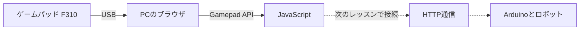

# レッスン43　ゲームパッドの信号を読み取ろう！

## 今回の目的：ゲームパッドでロボットを動かすための準備

これまでタブレットで操作していたロボットを、**ゲームパッドで操作できるように改造**しています。

レッスン41ではプログラムを整理し、レッスン42ではArduinoにWebサーバーを作って、ブラウザの操作画面からロボットに命令を送る仕組みを学びました。

**ゲームパッド → PCのブラウザ → Wi-Fi・HTTP → Arduino → ロボット**

今回は、このつながりの最初の部分、**ゲームパッドからPCに届く信号をJavaScriptで読み取る**ことに挑戦します。

> **今日のゴール：** ロジクール F310の十字キーとボタンを押したとき、どの信号が届いたかをブラウザに表示できるようにする。**今回はまだロボットを動かしません。**

### このレッスンで身につける力

- [ ] HTML・CSS・JavaScriptの役割のちがいを説明できる
- [ ] ゲームパッドの信号がPCのブラウザに届き、JavaScriptで読み取るしくみを説明できる
- [ ] メモ帳かVS Codeで `gamepad_test.html` を作り、`localhost` でブラウザに表示できる
- [ ] `navigator.getGamepads()` の役割を説明できる
- [ ] `.pressed` が何を表すか説明できる
- [ ] 十字キーとA・B・X・Yボタンの番号を調べられる
- [ ] 押しているボタン番号を、JavaScriptで画面に表示できる

---

## ミッション1　ゲームパッドの信号はどこへ届く？



ゲームパッドはArduinoに直接つなぐのではありません。**PCがゲームパッドの信号を受け取り、JavaScriptがその内容を調べます。**

- **Gamepad API**：ブラウザからゲームパッドの状態を調べるための仕組み。
- **ボタン**：押されているかどうかを読み取れる。
- **十字キー**：多くのゲームパッドでは4つのボタンとして読み取れる。
- **アナログスティック**：倒した方向や大きさを数値で読み取れる。こちらはレッスン45で扱います。

**考えてみよう：** ゲームパッドの「上」が押されたことを知るだけで、ロボットは前進できるでしょうか？ それとも、何か別の処理が必要でしょうか？

---

## ミッション2　ゲームパッドをPCに接続しよう

### 準備するもの

- [ ] PCとChrome
- [ ] ロジクール F310（USB有線ゲームパッド）
- [ ] メモ帳 または VS Code

1. F310の背面スイッチを **X** にして、PCに接続します。
2. Chromeで [Gamepad Tester](https://hardwaretester.com/gamepad) を開きます。
3. ゲームパッドのボタンを1回押します。
4. 十字キーや各ボタンを押し、画面に反応が出るか確かめます。

> **注意：** F310のボタン番号は接続モードやブラウザ環境で変わる場合があります。番号は決めつけず、**自分のPCで調べた結果**を使います。

**十字キーを押しても反応せず、左のスティックで反応するときは：** F310の **MODE** ボタンのランプが点いていないか確かめましょう。点いていたら、MODEボタンを押してランプを消します。

- [ ] 十字キーが認識された
- [ ] A・B・X・Yボタンが認識された

---

## ここで勉強：HTMLとJavaScriptってなに？

### Webページは3つの言葉でできている

ブラウザに表示されるWebページは、3つの言葉を組み合わせて作られています。ロボットにたとえると、次のようになります。

| 言葉 | 役割 | ロボットにたとえると |
|---|---|---|
| **HTML** | 画面に何をならべるか（見出し、文、ボタンなど） | 体（シャーシ、タイヤ、センサーなどの部品） |
| **CSS** | どんな見た目にするか（色、大きさ、ならべ方） | 色をぬったり、シールをはったりすること |
| **JavaScript** | どう動かすか（ボタンを調べる、画面を書きかえる） | Arduinoのプログラム |

レッスン42では、HTMLとCSSで操作画面を作りました。今回は、**JavaScript** を使って、ゲームパッドの信号を読み取ります。

### HTMLのふりかえり

HTMLは、**タグ**で部品をはさんで書くのでした（レッスン42の4章）。

```html
<p id="status">接続待ち</p>
```

- `<p>` 〜 `</p>` は「1つの文」という部品です。
- `id="status"` は、この部品の**名前札**です。JavaScriptは、この名前札を使って部品を見つけ、中の文字を書きかえます。
- `<script>` 〜 `</script>` のあいだには、JavaScriptのプログラムを書きます。

### JavaScriptは、ブラウザの中で動くプログラム

Arduinoのプログラムは、Arduinoの中で動きます。JavaScriptのプログラムは、**ブラウザ（Chrome）の中で動きます**。言葉はちがいますが、似ているところがたくさんあります。

| やりたいこと | Arduino（C++） | JavaScript |
|---|---|---|
| 変数を作る | `int count = 0;` | `let count = 0;` |
| 変えない値を作る | `#define SPEED 150` | `const speed = 150;` |
| 関数を作る | `void update() { ... }` | `function update() { ... }` |
| もし〜なら | `if (x > 0) { ... }` | `if (x > 0) { ... }`（同じ！） |
| コメント | `// コメント` | `// コメント`（同じ！） |
| 文字を表示する | `Serial.println("こんにちは");` | `console.log("こんにちは");` |
| くり返す | `loop()` がひとりでにくり返される | `requestAnimationFrame(update);` で、自分でくり返しをたのむ |

**ちがうところ：**

- JavaScriptでは、変数を作るときに `int` や `char` のような**型を書きません**。`let`（あとで変える変数）か `const`（変えない値）を書くだけです。
- 文字は `"` でかこみます。Arduinoと同じです。
- 文の終わりの `;` は、Arduinoと同じように書きます。

### JavaScriptでHTMLの部品を書きかえる

JavaScriptからHTMLの部品を書きかえるときは、次のように書きます。

```javascript
document.getElementById("status").textContent = "ゲームパッドが見つかりません";
```

- `document` は「今表示しているページ」
- `.getElementById("status")` は「名前札（id）が `status` の部品を見つける」
- `.textContent = "..."` は「その部品の中の文字を、`"..."` に書きかえる」

つまり、「ページの中から `status` という名前札の部品を見つけて、中の文字を『ゲームパッドが見つかりません』に書きかえる」という意味です。Arduinoで `Serial.println()` を使ってシリアルモニターに文字を出したのと同じように、JavaScriptではこの書き方で**画面に文字を出します**。

- [ ] HTML・CSS・JavaScriptの役割のちがいを説明できたらチェック！

---

## ミッション3　JavaScriptでボタンの状態を調べよう

ブラウザには、接続中のゲームパッドを取得する命令があります。

```javascript
const pads = navigator.getGamepads();
const pad = pads[0];
```

`pads[0]` は最初のゲームパッドです。ゲームパッドが見つからない場合もあるので、実際のプログラムでは確認が必要です。

ボタンの状態は、次のように調べられます。

```javascript
const pressed = pad.buttons[0].pressed;
```

`pressed` は、押しているとき `true`、押していないとき `false` になります。

**ポイント：** `buttons[0]` の `0` は「ボタン番号0」という意味です。必ずしもAボタンとは限りません。

---

## ミッション4　ボタンの番号を表示するページを作ろう

`gamepad_test.html` というファイルを作り、PCの中の小さなWebサーバー（`localhost`）から開きます。

ファイルは、**メモ帳**でも **VS Code** でも作れます。やりやすいほうを選びましょう。

#### 手順1　拡張子が見えるようにする

ファイルの名前の最後にある `.ino` や `.h` や `.html` のような部分を、**拡張子**といいます。拡張子は「このファイルは何のファイルか」を表す名札です。

| 拡張子 | 何のファイルか |
|---|---|
| `.ino` | Arduinoのスケッチ |
| `.h` | Arduinoのヘッダーファイル（レッスン41で作ったもの） |
| `.txt` | ただの文字のファイル（メモ帳でふつうに保存するとこれになる） |
| `.html` | Webページのファイル（今回作るもの） |

Windowsは、はじめは拡張子をかくしています。このままだと、`gamepad_test.html` のつもりが、本当は `gamepad_test.html.txt` になっていても気づけません。そこで、拡張子が見えるようにしておきます。

1. エクスプローラー（フォルダーの形のアイコン）を開きます。
2. 上のメニューの **表示 → 表示 → ファイル名拡張子** を選んで、チェックを付けます。

これで、ファイルの名前のうしろに `.ino` や `.txt` などが見えるようになります。

#### 手順2　保存するフォルダーを決める

`gamepad_test.html` を保存するフォルダーを決めます。自分の作品を保存しているフォルダーを使いましょう。

#### 手順3　`gamepad_test.html` を作る

**方法A：メモ帳で作る**

1. スタートボタンを押して「メモ帳」と入力し、**メモ帳**を開きます。
2. 下の灰色のわくの右上にある**コピーボタン**を押して、わくの中を全部コピーします。
3. メモ帳に**貼り付け**（`Ctrl` + `V`）ます。
4. メモ帳のメニューで **ファイル → 名前を付けて保存** を選びます。
5. 保存する画面で、次の4つを確かめてから **保存** を押します。

| 項目 | 選ぶもの・入力するもの |
|---|---|
| 保存する場所 | 手順2で決めたフォルダー |
| ファイル名 | `gamepad_test.html` |
| ファイルの種類 | **すべてのファイル (\*.\*)**（「テキスト文書 (\*.txt)」のままだと、`.txt` が付いてしまう） |
| エンコード（文字コード） | **UTF-8**（日本語が文字化けしないようにするため） |

6. エクスプローラーでフォルダーを開き、`gamepad_test.html` という名前で保存されているか確かめます。`gamepad_test.html.txt` になっていたら、ファイルの種類が「テキスト文書」のままでした。もう一度、手順3の4からやり直しましょう。

**方法B：VS Codeで作る**

1. VS Codeを起動し、**ファイル → フォルダーを開く** で、手順2で決めたフォルダーを開きます。「このフォルダー内のファイルの作成者を信頼しますか？」と聞かれたら、**はい、作成者を信頼します** を押します。
2. 左側のエクスプローラーで、フォルダー名の横にある **新しいファイル** ボタン（紙に＋のマーク）を押します。
3. ファイル名に `gamepad_test.html` と入力して、`Enter` を押します。VS Codeでは、入力した名前がそのままファイル名になります。
4. 下の灰色のわくの中を全部コピーして、`gamepad_test.html` に**貼り付け**て、**保存**（`Ctrl` + `S`）します。

**注意（どちらの方法でも）：** 1行目が `<!DOCTYPE html>` になっているか確かめましょう。コピーのしかたによっては、`<` や `"` などの記号が消えてしまうことがあります。記号が消えていると動きません。

```html
<!DOCTYPE html>
<html lang="ja">
<head>
  <meta charset="UTF-8">
  <title>ゲームパッド入力テスト</title>
</head>
<body>
  <h1>ゲームパッド入力テスト</h1>
  <p>ゲームパッドのボタンを押してください。</p>
  <p id="status">接続待ち</p>
  <p id="buttons">押されているボタン：なし</p>

  <script>
    function update() {
      const pads = navigator.getGamepads();
      const pad = Array.from(pads).find(p => p !== null);

      if (!pad) {
        document.getElementById("status").textContent =
          "ゲームパッドが見つかりません";
        document.getElementById("buttons").textContent =
          "押されているボタン：なし";
      } else {
        document.getElementById("status").textContent =
          "接続中：" + pad.id;

        const pressed = [];
        pad.buttons.forEach((button, number) => {
          if (button.pressed) {
            pressed.push(number);
          }
        });

        document.getElementById("buttons").textContent =
          "押されているボタン：" +
          (pressed.length ? pressed.join(", ") : "なし");
      }

      requestAnimationFrame(update);
    }

    update();
  </script>
</body>
</html>
```

#### 手順4　Webサーバーを起動する

Gamepad APIは、安全な接続環境でだけ使える仕組みです。そのため、`gamepad_test.html` をダブルクリックして開くのではなく、**PC自身の `localhost`** という場所から開きます。そのために、PCの中に小さなWebサーバーを起動します。

**方法A：エクスプローラーから起動する（メモ帳で作った人）**

1. エクスプローラーで、`gamepad_test.html` があるフォルダーを開きます。
2. 上の**アドレスバー**（フォルダーの場所が書いてあるところ）をクリックして、`cmd` と入力し、`Enter` を押します。
3. 黒い画面（**コマンドプロンプト**）が開きます。

**方法B：VS Codeから起動する（VS Codeで作った人）**

1. VS Codeのメニューで **ターミナル → 新しいターミナル** を選びます。画面の下にターミナルが開きます。

**ここからは、どちらの方法でも同じです。**

開いた画面に次のコマンドを入力して、`Enter` を押します。

```bash
python -m http.server 8000
```

`Serving HTTP on ... port 8000` のように表示されたら、Webサーバーが起動しています。この画面は**閉じずにそのまま**にしておきます。

**「Windowsセキュリティの重要な警告」などの画面が出たときは：** 今回は自分のPCの中だけで使うので、**キャンセル**を押してOKです。

※ Pythonが `python` で起動しない環境では `python3 -m http.server 8000` を試してください。

#### 手順5　Chromeでページを開く

1. Chromeのアドレスバーに `http://localhost:8000/gamepad_test.html` と入力して開きます。
2. ゲームパッドのボタンを**一度押します**（ボタンを押すまで、ブラウザはゲームパッドを見つけてくれません）。
3. 「接続中：」のうしろにゲームパッドの名前が出て、押したボタンの番号が表示されたら成功です。

#### 手順6　終わるとき

コマンドプロンプト（またはVS Codeのターミナル）をクリックして、`Ctrl` + `C` を押すと、Webサーバーが止まります。コマンドプロンプトは、そのあと閉じてかまいません。

#### 手順7　プログラムを読んでみよう

動いたら、`gamepad_test.html` のプログラムを、かたまりごとに読んでみましょう。

**① HTMLの部分（`<body>` の中）**

```html
<p id="status">接続待ち</p>
<p id="buttons">押されているボタン：なし</p>
```

画面に文を2つならべています。`id="status"` と `id="buttons"` が名前札です。JavaScriptは、この2つの部品の文字を書きかえて、結果を表示します。

**② `update()` 関数をくり返す**

```javascript
function update() {
  ...（ゲームパッドを調べて、画面を書きかえる）
  requestAnimationFrame(update);
}

update();
```

- `function update() { ... }` で、`update` という関数を作っています。
- いちばん下の `update();` で、1回目の `update()` を動かします。
- `update()` の最後にある `requestAnimationFrame(update);` は、「画面を書きかえるタイミングで、もう一度 `update` を動かしてね」というお願いです。1秒間に60回ほど、`update()` がくり返し動きます。Arduinoの `loop()` と同じ役目です。

**③ ゲームパッドを見つける**

```javascript
const pads = navigator.getGamepads();
const pad = Array.from(pads).find(p => p !== null);
```

- `navigator.getGamepads()` で、PCにつながっているゲームパッドの**一覧**を取り出します。
- 一覧には、つながっていないところが `null`（空っぽ）として入っていることがあります。
- 2行目は、「一覧の中から、**空っぽではない最初のゲームパッド**を見つけて、`pad` に入れる」という意味です。見つからなければ、`pad` は空っぽになります。

**④ 見つからなかったとき・見つかったとき**

```javascript
if (!pad) {
  // 見つからなかったとき
} else {
  // 見つかったとき
}
```

`!pad` は「`pad` が空っぽなら」という意味です（`!` は「〜ではない」）。Arduinoの `if` 〜 `else` と同じ書き方です。

- 見つからなかったときは、`status` に「ゲームパッドが見つかりません」と書きます。
- 見つかったときは、`status` に「接続中：」とゲームパッドの名前（`pad.id`）を書きます。

**⑤ 押されているボタンを1つずつ調べる**

```javascript
const pressed = [];
pad.buttons.forEach((button, number) => {
  if (button.pressed) {
    pressed.push(number);
  }
});
```

- `const pressed = [];` で、空っぽの**リスト**（Arduinoの配列のようなもの）を作ります。
- `pad.buttons.forEach(...)` は、「ゲームパッドのボタンを、0番から順番に**1つずつ**調べる」という意味です。Arduinoの `for` 文のようなものです。`number` にボタンの番号、`button` にそのボタンの様子が入ります。
- `button.pressed` が `true`（押されている）なら、`pressed.push(number);` でその番号をリストに足します。

**⑥ 結果を画面に表示する**

```javascript
document.getElementById("buttons").textContent =
  "押されているボタン：" +
  (pressed.length ? pressed.join(", ") : "なし");
```

- `pressed.length` は、リストに入っている番号の数です。
- `( 条件 ? Aのとき : Bのとき )` は、「条件が当てはまればA、当てはまらなければB」という短い `if` 文です。ここでは、「押されたボタンが1つ以上あれば、番号を `, ` でつないだもの（例：`0, 12`）。1つもなければ『なし』」という意味になります。
- その文字を、`buttons` という名前札の部品に書きこみます。

**実験してみよう！** 十字キーの上を押すと何番が表示されるでしょう？ 下・左・右ではどうでしょう？

- [ ] `gamepad_test.html` を作れたらチェック！
- [ ] `localhost` でページを開いて、ボタン番号が表示されたらチェック！

**うまくいかないときは：**

| 表示・ようす | 確かめること |
|---|---|
| ページが開かない | Webサーバーが動いているか（手順4）。アドレスのつづり。ファイル名が `gamepad_test.html.txt` になっていないか（手順3） |
| 「ゲームパッドが見つかりません」のまま | ゲームパッドのボタンを一度押したか。USBがささっているか |
| 画面に記号のような文字が出る、何も表示されない | `gamepad_test.html` の記号が消えていないか（手順3の注意） |

完成例と見比べたいときは、[完成例の gamepad_test.html](https://github.com/kobayashi-makoto2021/robobu/blob/main/Lesson_43/sample/gamepad_test.html) を開いて、右上の**ダウンロード**ボタンで保存できます。

---

## ミッション5　十字キーとボタンの番号を調べよう

画面に表示された番号を記録します。

| 操作 | 調べたボタン番号 |
|---|---|
| 十字キー 上 | ＿＿＿＿ |
| 十字キー 下 | ＿＿＿＿ |
| 十字キー 左 | ＿＿＿＿ |
| 十字キー 右 | ＿＿＿＿ |
| Aボタン | ＿＿＿＿ |
| Bボタン | ＿＿＿＿ |
| Xボタン | ＿＿＿＿ |
| Yボタン | ＿＿＿＿ |

### 発展：押されたボタンに名前を付けよう

例えば、調べた番号を使って次のようなプログラムを作れます。

```javascript
// 例：上ボタンが12番だった場合
if (pad.buttons[12].pressed) {
  console.log("上が押された！");
}
```

**注意：** `12` は例です。ミッション5で自分が調べた番号に書き換えてください。

`console.log()` の表示は、Chromeで `F12` キーを押して開く「デベロッパーツール」の **Console** に出ます。

---

## まとめ

ゲームパッドの信号は、まずPCに届きます。JavaScriptは**Gamepad API**を使って、その信号を読み取れます。

今回は「どのボタンが押されたか」を調べました。しかし、**信号を読み取ること**と、**ロボットを動かすこと**は別の仕事です。

- **HTML**：画面に何をならべるかを書く言葉。タグ（`<p>` 〜 `</p>` など）で部品をはさむ
- **CSS**：色や大きさ、ならべ方など、見た目を決める言葉
- **JavaScript**：ブラウザの中で動くプログラムの言葉。Arduinoのプログラムとよく似ている
- **id**：HTMLの部品の名前札。JavaScriptは `document.getElementById()` で部品を見つけて書きかえる
- **Gamepad API**：ブラウザからゲームパッドの状態を調べる仕組み
- **`navigator.getGamepads()`**：つながっているゲームパッドの一覧を取り出す命令
- **`.pressed`**：ボタンが押されていれば `true`、押されていなければ `false`
- **`localhost`**：自分のPCのこと。`http://localhost:8000/` で、自分のPCの中のWebサーバーにアクセスできる
- **`requestAnimationFrame()`**：画面を書きかえるたびに、関数をくり返し呼んでもらう命令

### 出来たことをチェックしよう

- [ ] HTML・CSS・JavaScriptの役割のちがいを説明できる
- [ ] ゲームパッドの信号がPCのブラウザに届き、JavaScriptで読み取るしくみを説明できる
- [ ] メモ帳かVS Codeで `gamepad_test.html` を作り、`localhost` でブラウザに表示できる
- [ ] `navigator.getGamepads()` の役割を説明できる
- [ ] `.pressed` が何を表すか説明できる
- [ ] 十字キーとA・B・X・Yボタンの番号を調べられる
- [ ] 押しているボタン番号を、JavaScriptで画面に表示できる

### 次回：レッスン44「ゲームパッドでロボットを動かそう！」

今回読み取った十字キーの信号に「前進」「後退」「左旋回」「右旋回」などの命令を割り当て、HTTP通信でArduinoに伝えます。

---

*講師向けメモ：Gamepad API（`navigator.getGamepads()`）はセキュアコンテキストが必要で、Chrome 86以降は HTTPS か `localhost` で開いたページでしか使えません（それ以外では空の一覧が返ります）。そのため、レッスン42のようにArduinoのIPアドレス（`http://192.168...`）から配信したページでは使えない可能性が高く、レッスン43以降は操作画面をPCの `localhost`（`python -m http.server`）から開く構成にしています。F310を背面スイッチ「X」（XInput）でつなぐと、Chromeでは標準配置（standard mapping）になり、一般的には A=0、B=1、X=2、Y=3、十字キー 上=12・下=13・左=14・右=15 です（答え合わせ用。生徒には自分で調べさせてください）。レッスン44では、`localhost` のページからロボット（`http://192.168...`）へ `/M` などの命令を送ります。Chromeのローカルネットワークアクセス制限は、より内側のアドレス空間（`localhost`）からの通信には確認画面を出さないため、中継サーバーなしで送れる見込みです。CORSについては、レスポンスを読まない `fetch(..., {mode: "no-cors"})` か、`http.h` の返事に `Access-Control-Allow-Origin: *` を足して対応する予定です（レッスン44で実機確認）。*
