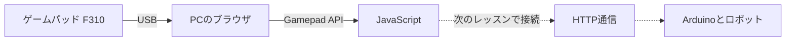

# レッスン43　ゲームパッドの信号を読み取ろう！

## 今回の目的：ゲームパッドでロボットを動かすための準備

これまでタブレットで操作していたロボットを、**ゲームパッドで操作できるように改造**しています。

レッスン41ではプログラムを整理し、レッスン42ではArduinoにWebサーバーを作って、ブラウザの操作画面からロボットに命令を送る仕組みを学びました。

**ゲームパッド → PCのブラウザ → Wi-Fi・HTTP → Arduino → ロボット**

今回は、このつながりの最初の部分、**ゲームパッドからPCに届く信号をJavaScriptで読み取る**ことに挑戦します。

> **今日のゴール：** ロジクール F310の十字キーとボタンを押したとき、どの信号が届いたかをブラウザに表示できるようにする。**今回はまだロボットを動かしません。**

### このレッスンで身につける力

- [ ] ゲームパッドの信号がPCのブラウザに届き、JavaScriptで読み取るしくみを説明できる
- [ ] VS Codeで `gamepad_test.html` を作り、`localhost` でブラウザに表示できる
- [ ] `navigator.getGamepads()` の役割を説明できる
- [ ] `.pressed` が何を表すか説明できる
- [ ] 十字キーとA・B・X・Yボタンの番号を調べられる
- [ ] 押しているボタン番号を、JavaScriptで画面に表示できる

---

## ミッション1　ゲームパッドの信号はどこへ届く？



ゲームパッドはArduinoに直接つなぐのではありません。**PCがゲームパッドの信号を受け取り、JavaScriptがその内容を調べます。**

- **Gamepad API**：ブラウザからゲームパッドの状態を調べるための仕組み。
- **ボタン**：押されているかどうかを読み取れる。
- **十字キー**：多くのゲームパッドでは4つのボタンとして読み取れる。
- **アナログスティック**：倒した方向や大きさを数値で読み取れる。こちらはレッスン45で扱います。

**考えてみよう：** ゲームパッドの「上」が押されたことを知るだけで、ロボットは前進できるでしょうか？ それとも、何か別の処理が必要でしょうか？

---

## ミッション2　ゲームパッドをPCに接続しよう

### 準備するもの

- [ ] PCとChrome
- [ ] ロジクール F310（USB有線ゲームパッド）
- [ ] VS Code

1. F310の背面スイッチを **X** にして、PCに接続します。
2. Chromeで [Gamepad Tester](https://hardwaretester.com/gamepad) を開きます。
3. ゲームパッドのボタンを1回押します。
4. 十字キーや各ボタンを押し、画面に反応が出るか確かめます。

> **注意：** F310のボタン番号は接続モードやブラウザ環境で変わる場合があります。番号は決めつけず、**自分のPCで調べた結果**を使います。

**十字キーを押しても反応せず、左のスティックで反応するときは：** F310の **MODE** ボタンのランプが点いていないか確かめましょう。点いていたら、MODEボタンを押してランプを消します。

- [ ] 十字キーが認識された
- [ ] A・B・X・Yボタンが認識された

---

## ミッション3　JavaScriptでボタンの状態を調べよう

ブラウザには、接続中のゲームパッドを取得する命令があります。

```javascript
const pads = navigator.getGamepads();
const pad = pads[0];
```

`pads[0]` は最初のゲームパッドです。ゲームパッドが見つからない場合もあるので、実際のプログラムでは確認が必要です。

ボタンの状態は、次のように調べられます。

```javascript
const pressed = pad.buttons[0].pressed;
```

`pressed` は、押しているとき `true`、押していないとき `false` になります。

**ポイント：** `buttons[0]` の `0` は「ボタン番号0」という意味です。必ずしもAボタンとは限りません。

---

## ミッション4　ボタンの番号を表示するページを作ろう

VS Codeで `gamepad_test.html` というファイルを作り、PCの中の小さなWebサーバー（`localhost`）から開きます。

#### 手順1　VS Codeで、保存するフォルダーを開く

1. VS Codeを起動します。
2. **ファイル → フォルダーを開く** を選び、自分の作品を保存しているフォルダーを開きます。
3. 「このフォルダー内のファイルの作成者を信頼しますか？」と聞かれたら、**はい、作成者を信頼します** を押します。

#### 手順2　`gamepad_test.html` を作る

1. 左側のエクスプローラーで、フォルダー名の横にある **新しいファイル** ボタン（紙に＋のマーク）を押します。
2. ファイル名に `gamepad_test.html` と入力して、`Enter` を押します。
3. 下の灰色のわくの右上にある**コピーボタン**を押して、わくの中を全部コピーします。
4. VS Codeの `gamepad_test.html` に**貼り付け**（`Ctrl` + `V`）て、**保存**（`Ctrl` + `S`）します。

**注意：** 1行目が `<!DOCTYPE html>` になっているか確かめましょう。コピーのしかたによっては、`<` や `"` などの記号が消えてしまうことがあります。記号が消えていると動きません。

```html
<!DOCTYPE html>
<html lang="ja">
<head>
  <meta charset="UTF-8">
  <title>ゲームパッド入力テスト</title>
</head>
<body>
  <h1>ゲームパッド入力テスト</h1>
  <p>ゲームパッドのボタンを押してください。</p>
  <p id="status">接続待ち</p>
  <p id="buttons">押されているボタン：なし</p>

  <script>
    function update() {
      const pads = navigator.getGamepads();
      const pad = Array.from(pads).find(p => p !== null);

      if (!pad) {
        document.getElementById("status").textContent =
          "ゲームパッドが見つかりません";
        document.getElementById("buttons").textContent =
          "押されているボタン：なし";
      } else {
        document.getElementById("status").textContent =
          "接続中：" + pad.id;

        const pressed = [];
        pad.buttons.forEach((button, number) => {
          if (button.pressed) {
            pressed.push(number);
          }
        });

        document.getElementById("buttons").textContent =
          "押されているボタン：" +
          (pressed.length ? pressed.join(", ") : "なし");
      }

      requestAnimationFrame(update);
    }

    update();
  </script>
</body>
</html>
```

#### 手順3　VS Codeのターミナルで、Webサーバーを起動する

Gamepad APIは、安全な接続環境でだけ使える仕組みです。今回は**PC自身の `localhost`** からページを開きます。

1. VS Codeのメニューで **ターミナル → 新しいターミナル** を選びます。画面の下にターミナルが開きます。
2. ターミナルに次のコマンドを入力して、`Enter` を押します。

```bash
python -m http.server 8000
```

3. `Serving HTTP on ... port 8000` のように表示されたら、Webサーバーが起動しています。このターミナルは**閉じずにそのまま**にしておきます。

**「Windowsセキュリティの重要な警告」などの画面が出たときは：** 今回は自分のPCの中だけで使うので、**キャンセル**を押してOKです。

※ Pythonが `python` で起動しない環境では `python3 -m http.server 8000` を試してください。

#### 手順4　Chromeでページを開く

1. Chromeのアドレスバーに `http://localhost:8000/gamepad_test.html` と入力して開きます。
2. ゲームパッドのボタンを**一度押します**（ボタンを押すまで、ブラウザはゲームパッドを見つけてくれません）。
3. 「接続中：」のうしろにゲームパッドの名前が出て、押したボタンの番号が表示されたら成功です。

#### 手順5　終わるとき

VS Codeのターミナルをクリックして、`Ctrl` + `C` を押すと、Webサーバーが止まります。

**実験してみよう！** 十字キーの上を押すと何番が表示されるでしょう？ 下・左・右ではどうでしょう？

- [ ] `gamepad_test.html` を作れたらチェック！
- [ ] `localhost` でページを開いて、ボタン番号が表示されたらチェック！

**うまくいかないときは：**

| 表示・ようす | 確かめること |
|---|---|
| ページが開かない | ターミナルでWebサーバーが動いているか（手順3）。アドレスのつづり |
| 「ゲームパッドが見つかりません」のまま | ゲームパッドのボタンを一度押したか。USBがささっているか |
| 画面に記号のような文字が出る、何も表示されない | `gamepad_test.html` の記号が消えていないか（手順2の注意） |

完成例と見比べたいときは、[完成例の gamepad_test.html](https://github.com/kobayashi-makoto2021/robobu/blob/main/Lesson_43/sample/gamepad_test.html) を開いて、右上の**ダウンロード**ボタンで保存できます。

---

## ミッション5　十字キーとボタンの番号を調べよう

画面に表示された番号を記録します。

| 操作 | 調べたボタン番号 |
|---|---|
| 十字キー 上 | ＿＿＿＿ |
| 十字キー 下 | ＿＿＿＿ |
| 十字キー 左 | ＿＿＿＿ |
| 十字キー 右 | ＿＿＿＿ |
| Aボタン | ＿＿＿＿ |
| Bボタン | ＿＿＿＿ |
| Xボタン | ＿＿＿＿ |
| Yボタン | ＿＿＿＿ |

### 発展：押されたボタンに名前を付けよう

例えば、調べた番号を使って次のようなプログラムを作れます。

```javascript
// 例：上ボタンが12番だった場合
if (pad.buttons[12].pressed) {
  console.log("上が押された！");
}
```

**注意：** `12` は例です。ミッション5で自分が調べた番号に書き換えてください。

`console.log()` の表示は、Chromeで `F12` キーを押して開く「デベロッパーツール」の **Console** に出ます。

---

## まとめ

ゲームパッドの信号は、まずPCに届きます。JavaScriptは**Gamepad API**を使って、その信号を読み取れます。

今回は「どのボタンが押されたか」を調べました。しかし、**信号を読み取ること**と、**ロボットを動かすこと**は別の仕事です。

- **Gamepad API**：ブラウザからゲームパッドの状態を調べる仕組み
- **`navigator.getGamepads()`**：つながっているゲームパッドの一覧を取り出す命令
- **`.pressed`**：ボタンが押されていれば `true`、押されていなければ `false`
- **`localhost`**：自分のPCのこと。`http://localhost:8000/` で、自分のPCの中のWebサーバーにアクセスできる
- **`requestAnimationFrame()`**：画面を書きかえるたびに、関数をくり返し呼んでもらう命令

### 出来たことをチェックしよう

- [ ] ゲームパッドの信号がPCのブラウザに届き、JavaScriptで読み取るしくみを説明できる
- [ ] VS Codeで `gamepad_test.html` を作り、`localhost` でブラウザに表示できる
- [ ] `navigator.getGamepads()` の役割を説明できる
- [ ] `.pressed` が何を表すか説明できる
- [ ] 十字キーとA・B・X・Yボタンの番号を調べられる
- [ ] 押しているボタン番号を、JavaScriptで画面に表示できる

### 次回：レッスン44「ゲームパッドでロボットを動かそう！」

今回読み取った十字キーの信号に「前進」「後退」「左旋回」「右旋回」などの命令を割り当て、HTTP通信でArduinoに伝えます。

---

*講師向けメモ：Gamepad API（`navigator.getGamepads()`）はセキュアコンテキストが必要で、Chrome 86以降は HTTPS か `localhost` で開いたページでしか使えません（それ以外では空の一覧が返ります）。そのため、レッスン42のようにArduinoのIPアドレス（`http://192.168...`）から配信したページでは使えない可能性が高く、レッスン43以降は操作画面をPCの `localhost`（`python -m http.server`）から開く構成にしています。F310を背面スイッチ「X」（XInput）でつなぐと、Chromeでは標準配置（standard mapping）になり、一般的には A=0、B=1、X=2、Y=3、十字キー 上=12・下=13・左=14・右=15 です（答え合わせ用。生徒には自分で調べさせてください）。レッスン44では、`localhost` のページからロボット（`http://192.168...`）へ `/M` などの命令を送ります。Chromeのローカルネットワークアクセス制限は、より内側のアドレス空間（`localhost`）からの通信には確認画面を出さないため、中継サーバーなしで送れる見込みです。CORSについては、レスポンスを読まない `fetch(..., {mode: "no-cors"})` か、`http.h` の返事に `Access-Control-Allow-Origin: *` を足して対応する予定です（レッスン44で実機確認）。*
