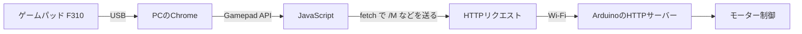

# レッスン44　ゲームパッドでロボットを動かそう！

## 今回の目的：ゲームパッドの信号をロボットの動きにつなげる

これまでタブレットで操作していたロボットを、**ゲームパッドで操作できるロボット**へ改造しています。

- **レッスン41**：プログラムをモジュール化し、通信部分を変更しやすくしました。
- **レッスン42**：ArduinoをHTTPサーバーにして、ブラウザのボタンで動かしました。
- **レッスン43**：PCのJavaScriptで、ゲームパッドの十字キーやボタンの信号を読み取りました。

今回は、**十字キーの信号をHTTPの命令に変え、Arduinoへ届けて、ロボットを動かします。**

> **今日のゴール：** 十字キーの上下左右でロボットが動き、キーを離すと停止する。アナログスティックはレッスン45、各ボタンへの自由な機能割り当てはレッスン46で扱います。

### このレッスンで身につける力

- [ ] ゲームパッドの入力から、ロボットが動くまでの流れを説明できる
- [ ] 十字キーの入力を、ロボットへの命令（`/M` など）に対応させられる
- [ ] JavaScriptの `fetch()` で、PCからロボットに命令を送れる
- [ ] キーを押している間は動き、離すと止まることを確かめられる
- [ ] 入力の処理（PC）とモーターの制御（Arduino）が別の役割だと説明できる

---

## ミッション1　入力から動作までの道筋を確認しよう



ゲームパッドはArduinoに直接つながりません。PCが信号を読み取り、JavaScriptがHTTPリクエストを送ります。

**今回もPC側のページを `localhost` で開きます。** レッスン43で学んだとおり、Gamepad APIは安全な実行環境（`localhost` など）でしか使えないからです。ページはPCにあり、そこからロボットのIPアドレスに命令を送ります。

**ロボット側のプログラムは、レッスン42のまま変えません。** レッスン42の操作画面のボタンが送っていた `/M` などの命令を、今度はゲームパッドから送るだけです。

---

## ミッション2　十字キーと命令を対応させよう

レッスン42で、ロボットはタブレットのアプリと同じ1文字の命令を受け取るようにしました。十字キーを、その命令に対応させます。

| ゲームパッドの操作 | JavaScriptで判断する内容 | ロボットに送る命令 | ロボットの動き |
|---|---|---|---|
| 十字キー 上 | 上ボタンが押された | `/M` | 前進 |
| 十字キー 下 | 下ボタンが押された | `/B` | 後退 |
| 十字キー 左 | 左ボタンが押された | `/L` | 左旋回 |
| 十字キー 右 | 右ボタンが押された | `/R` | 右旋回 |
| 十字キーを離す | 方向ボタンが押されていない | `/E` | 停止 |

※ F310のボタン番号は、レッスン43でノートにまとめた値を使います。以下のサンプルの `12, 13, 14, 15` は**例**です。

**考えてみよう：** レッスン42では、ロボットは命令を受け取ってから `moveTime`（はじめは0.5秒）たつと、自動で止まるようにしました。十字キーを押しっぱなしにしているとき、命令を1回送るだけで、ロボットは走り続けられるでしょうか？

---

## ミッション3　準備しよう

### 準備するもの

- [ ] レッスン42のプログラムを書き込んだロボット
- [ ] ロボットと同じWi-FiにつながるPC
- [ ] ロジクール F310
- [ ] Chrome、Python
- [ ] メモ帳 または VS Code
- [ ] レッスン43でボタン番号をまとめたノート

1. **安全のため、ロボットの車輪を浮かせて（箱の上にのせるなどして）作業しましょう。**
2. ロボットの電源を入れて、レッスン42と同じように、Chromeでロボットの操作画面（`http://192.168.〇.〇`）を開きます。ボタンで動くことを確かめます。
3. ロボットの**IPアドレス**（`192.168.〇.〇`）をノートに書いておきます。分からないときは、ロボットをUSBでPCにつなぎ、シリアルモニター（9600 baud）の `ブラウザで開くアドレス → http://...` を見ましょう。

- [ ] レッスン42の操作画面で、ロボットが動くことを確かめられたらチェック！
- [ ] ロボットのIPアドレスをノートに書けたらチェック！

---

## ミッション4　ゲームパッドで命令を送るページを作ろう

#### 手順1　`controller.html` を作る

レッスン43の `gamepad_test.html` と同じフォルダーに、`controller.html` というファイルを作ります。作り方は、レッスン43のミッション3の手順3と同じです。

- **メモ帳で作る人：** 貼り付けたら **ファイル → 名前を付けて保存** で、ファイル名を `controller.html`、ファイルの種類を **すべてのファイル (\*.\*)**、エンコードを **UTF-8** にして保存します。
- **VS Codeで作る人：** **新しいファイル** ボタンで `controller.html` を作り、貼り付けて保存（`Ctrl` + `S`）します。

下の灰色のわくの右上にある**コピーボタン**で、わくの中を全部コピーして貼り付けます。1行目が `<!DOCTYPE html>` になっているか（記号が消えていないか）確かめましょう。

```html
<!DOCTYPE html>
<html lang="ja">
<head>
  <meta charset="UTF-8">
  <title>レッスン44 ゲームパッド操作</title>
</head>
<body>
  <h1>ゲームパッドでロボットを動かそう！</h1>

  <p>ロボットのIPアドレス：
    <input id="ip" type="text" placeholder="192.168.〇.〇">
  </p>

  <p>1回に動く時間：<b id="t">1000</b> ミリ秒</p>
  <input id="time" type="range" min="100" max="2000" step="100" value="1000">

  <p id="state">ゲームパッドのボタンを1回押してください</p>
  <p id="error"></p>

  <script>
    // ★ レッスン43でノートにまとめた番号に書きかえる（以下は例）
    const UP = 12;
    const DOWN = 13;
    const LEFT = 14;
    const RIGHT = 15;

    const ipBox = document.getElementById("ip");         // IPアドレスの入力らん
    const timeSlider = document.getElementById("time");  // 動く時間のスライダー

    let sending = false;                  // 今、ロボットに送っているところか
    let timeToSend = timeSlider.value;    // まだ送っていない「動く時間」（はじめに1回送る）
    let lastCommand = "E";                // さっき送った命令

    // 前に入れたIPアドレスを、ブラウザに覚えておいてもらう
    ipBox.value = localStorage.getItem("robotIP") || "";
    ipBox.addEventListener("change", () => {
      localStorage.setItem("robotIP", ipBox.value);
      timeToSend = timeSlider.value;   // つなぎなおしたら、動く時間も送りなおす
    });

    // スライダーを動かすと数字が変わり、手をはなすと動く時間を送る
    timeSlider.addEventListener("input", () => {
      document.getElementById("t").textContent = timeSlider.value;
    });
    timeSlider.addEventListener("change", () => {
      timeToSend = timeSlider.value;
    });

    // 入力されたIPアドレスから、ロボットのアドレスを作る
    // 例：「192.168.10.22」→「http://192.168.10.22」
    function robotURL() {
      let ip = ipBox.value.trim();
      ip = ip.replace(/^https?:\/\//, "");   // http:// を入れていたら取る
      ip = ip.replace(/\/+$/, "");           // 最後の / を取る
      return "http://" + ip;
    }

    // ゲームパッドのようすから、ロボットへの命令（1文字）を決める
    function readCommand(pad) {
      if (!pad) return "E";
      if (pad.buttons[UP].pressed) return "M";     // 前進
      if (pad.buttons[DOWN].pressed) return "B";   // 後退
      if (pad.buttons[LEFT].pressed) return "L";   // 左
      if (pad.buttons[RIGHT].pressed) return "R";  // 右
      return "E";                                  // 何も押していない → 停止
    }

    // ロボットに命令を送る（返事が来るまで待つ。そのあいだは次を送らない）
    async function send(path) {
      sending = true;
      try {
        await fetch(robotURL() + path, {
          mode: "no-cors",
          cache: "no-store",
          signal: AbortSignal.timeout(2000)   // 2秒たっても返事がなければ、あきらめる
        });
        document.getElementById("error").textContent = "";
      } catch (e) {
        document.getElementById("error").textContent =
          "ロボットにつながりません。IPアドレスを確かめましょう";
      }
      sending = false;
    }

    function update() {
      const pad = Array.from(navigator.getGamepads()).find(p => p !== null);
      const command = readCommand(pad);
      document.getElementById("state").textContent = "今の命令：" + command;

      if (ipBox.value.trim() === "") {
        document.getElementById("error").textContent =
          "ロボットのIPアドレスを入れてください";
      } else if (!sending) {
        // 前の命令を送り終わっていたら、次の命令を送る
        if (timeToSend !== null) {
          // 動く時間が変わっていたら、先にそれを送る
          send("/T" + timeToSend);
          timeToSend = null;
        } else if (command !== "E" || lastCommand !== "E") {
          //  ・押しているあいだ（E以外）は、くり返し送る（ロボットが止まらないように）
          //  ・はなしたときは、停止（E）を1回だけ送る
          send("/" + command);
          lastCommand = command;
        }
      }
      requestAnimationFrame(update);
    }

    update();
  </script>
</body>
</html>
```

#### 手順2　ボタンの番号を自分のものに書きかえる

`★` の付いたところを、レッスン43でノートにまとめた**十字キーの番号**に書きかえて、保存します。

```javascript
    // ★ レッスン43でノートにまとめた番号に書きかえる（以下は例）
    const UP = 12;
    const DOWN = 13;
    const LEFT = 14;
    const RIGHT = 15;
```

ロボットのIPアドレスと、1回に動く時間は、プログラムを書きかえずに**ページの画面から入力**します（手順3）。

#### 手順3　ページを開いて、動かしてみる

1. レッスン43のミッション3の手順4と同じように、`controller.html` のあるフォルダーで Webサーバーを起動します。

```bash
python -m http.server 8000
```

2. Chromeで `http://localhost:8000/controller.html` を開きます。
3. 「ロボットのIPアドレス」のらんに、ミッション3でノートに書いた**IPアドレス**（例：`192.168.10.22`）を入力して、`Enter` を押します。一度入れると、ブラウザが覚えておいてくれるので、次に開いたときは入力しなくてもだいじょうぶです。
4. ゲームパッドのボタンを**一度押して**、ゲームパッドを見つけてもらいます。
5. 十字キーを押して、ロボットが動くか確かめましょう。画面には「今の命令：M」のように、今送っている命令が表示されます。
6. 「1回に動く時間」のスライダーは、レッスン42の操作画面と同じです。動かして手をはなすと、ロボットの `moveTime` が変わります。はじめは1000ミリ秒（1秒）です。

**「ロボットにつながりません」と表示されたときは：**

- 画面に入れたIPアドレスがまちがっていないか（`192.168.〇.〇` の形になっているか）
- ロボットの電源が入っていて、Wi-Fiにつながっているか（レッスン42の操作画面が開けるか）
- PCが、ロボットと同じWi-Fiにつながっているか

- [ ] `controller.html` を作って、ボタンの番号を書きかえられたらチェック！
- [ ] ゲームパッドの十字キーで、ロボットが動いたらチェック！

#### 手順4　プログラムを読んでみよう

**① 十字キーのようすから、命令を決める（`readCommand`）**

```javascript
function readCommand(pad) {
  if (!pad) return "E";
  if (pad.buttons[UP].pressed) return "M";     // 前進
  ...
  return "E";                                  // 何も押していない → 停止
}
```

- レッスン43と同じように、`pad.buttons[番号].pressed` で、ボタンが押されているかを調べます。
- `return "M";` は、「この関数の答えは `"M"` です」と返して、関数をそこで終わりにする命令です。上から順番に調べて、最初に押されていたものの命令を返します。
- 何も押されていなければ、最後の `return "E";` で、停止の命令になります。

**② ロボットに命令を送る（`send`）**

```javascript
async function send(path) {
  sending = true;
  try {
    await fetch(robotURL() + path, {
      mode: "no-cors",
      cache: "no-store",
      signal: AbortSignal.timeout(2000)
    });
    ...
  } catch (e) {
    ...「ロボットにつながりません」と表示
  }
  sending = false;
}
```

- `fetch(robotURL() + path)` は、`http://192.168.〇.〇/M` のようなアドレスにリクエストを送る命令です。レッスン42で、ブラウザのボタンを押したときに送っていたものと同じリクエストです。
- `robotURL()` は、画面に入力したIPアドレスの前に `http://` を付けて、ロボットのアドレスを作る関数です。`http://` や最後の `/` をうっかり入れてしまっても、取りのぞいてから作り直すようにしています。
- `await` は、「ロボットから返事が来るまで待つ」という意味です。`await` を使う関数には、前に `async` を付けます。
- `mode: "no-cors"` は、「返事の中身は読まなくていいから、とにかく送ってね」という設定です。PCのページとロボットは別の場所にあるので、ふつうに送ると、ブラウザが「返事を読んではいけません」と止めてしまいます。今回は返事を読む必要がないので、この設定で送ります。
- `signal: AbortSignal.timeout(2000)` は、「2秒たっても返事がなければ、あきらめてね」という設定です。返事を待ったまま、次の命令が送れなくなるのを防ぎます。
- `try { ... } catch (e) { ... }` は、「`try` の中でうまくいかなかったら、`catch` の中をやる」という書き方です。ロボットにつながらなかったときに、画面にメッセージを出します。
- `sending` は「今、送っているところか」を覚えておく変数です。

**③ くり返し調べて、送る（`update`）**

```javascript
} else if (!sending) {
  if (timeToSend !== null) {
    send("/T" + timeToSend);      // 動く時間が変わっていたら、先にそれを送る
    timeToSend = null;
  } else if (command !== "E" || lastCommand !== "E") {
    send("/" + command);
    lastCommand = command;
  }
}
```

`!sending` は「前の命令を送り終わっている（ロボットから返事が来ている）」という意味です。送り終わっていたら、次のどちらかを送ります。

1. スライダーで「動く時間」が変わっていたら（`timeToSend` が空っぽでなければ）、先に `/T1000` のような命令を送ります。
2. そうでなければ、`command !== "E" || lastCommand !== "E"`、つまり「十字キーを押している、または、さっきまで押していた」ときに、命令を送ります（`||` は「または」）。

つまり、

- **押している間：** 返事が来るたびに、同じ命令をくり返し送ります。ロボットは命令を受け取るたびに `moveTime` を数え直すので、止まらずに動き続けます。
- **離したとき：** 停止の命令 `E` を1回だけ送ります。
- **何も押していない間：** 何も送りません。

**④ IPアドレスと、1回に動く時間を画面から入力する**

```html
<p>ロボットのIPアドレス：
  <input id="ip" type="text" placeholder="192.168.〇.〇">
</p>

<p>1回に動く時間：<b id="t">1000</b> ミリ秒</p>
<input id="time" type="range" min="100" max="2000" step="100" value="1000">
```

- `<input type="text">` は、文字を入力できるらんです。`placeholder` は、何も入れていないときにうすく表示される見本の文字です。
- `<input type="range">` は、レッスン42の操作画面と同じスライダーです。

```javascript
ipBox.value = localStorage.getItem("robotIP") || "";
ipBox.addEventListener("change", () => {
  localStorage.setItem("robotIP", ipBox.value);
  ...
});
```

- `addEventListener("change", ...)` は、「入力らんの中身が変わったら、`...` をやってね」というお願いです。
- `localStorage` は、ブラウザの中の小さな**メモ帳**です。`setItem` で書きこみ、`getItem` で読み出します。IPアドレスをここに書いておくので、ページを閉じても、次に開いたときに入力らんに残っています。

```javascript
timeSlider.addEventListener("change", () => {
  timeToSend = timeSlider.value;
});
```

スライダーから手をはなすと、`timeToSend` にその値が入ります。すると③の `update()` が、次のすきまで `/T1000` のような命令をロボットに送ります。ページを開いたときにも、はじめの値（1000）を1回送ります。

**どうして、はじめは1000ミリ秒（1秒）なの？：** ロボットが命令を受け取って返事をするまでには、少し時間がかかります。`moveTime` が短すぎると、押しっぱなしにしていても、次の命令が届く前にロボットが止まってしまい、カクカク動きます。少し長めにしておけば、なめらかに動き続けます。スライダーで短くしたり長くしたりして、ちょうどよい時間をさがしてみましょう。もしWi-Fiが切れて命令が届かなくなっても、ロボットは `moveTime` がたつと自動的に止まります。

---

## ミッション5　動きを確認し、直してみよう

次の操作を1つずつ試して、結果を**ノートに表を書いて記録**しましょう。

| 試す操作 | 予想した動き | 実際の動き | 成功？ |
|---|---|---|---|
| 上を押す | 前進 | | |
| 下を押す | 後退 | | |
| 左を押す | 左旋回 | | |
| 右を押す | 右旋回 | | |
| 上を押しっぱなしにする | 前進し続ける | | |
| キーを離す | 停止 | | |

**考えてみよう：** 左右が逆だったら、モーター制御（`motor.h`）を書き換える必要があるでしょうか？ それとも、`controller.html` の入力と命令の対応を変更すれば直せるでしょうか？

**追加実験：** 上と右を同時に押すと、今のプログラムはどう動きますか？ `readCommand` の `if` の順番と関係があるでしょうか？

**追加実験：** ロボットのシリアルモニター（9600 baud）を開いて、十字キーを押しっぱなしにしてみましょう。`GET /M HTTP/1.1` は、どのくらいの間かくで表示されるでしょうか？ スライダーで「1回に動く時間」をその間かくより短くすると、どうなるでしょうか？

---

## まとめ

**ゲームパッドの入力 → JavaScriptで命令に変換 → HTTPで送信 → Arduinoがモーターを動かす**、という流れがつながりました。

レッスン41で機能ごとにプログラムを整理し、レッスン42で命令をタブレットのアプリと同じ1文字にしておいたので、**ロボット側のプログラムを1行も変えずに**、新しい操作方法を追加できました。

- **`fetch()`**：JavaScriptから、HTTPリクエストを送る命令
- **`async` / `await`**：時間のかかること（ロボットからの返事など）が終わるまで待つための書き方
- **`try` / `catch`**：うまくいかなかったときの処理を書く書き方
- **`return`**：関数の答えを返して、関数を終わりにする命令
- **`||`**：「または」。どちらか片方でも当てはまれば OK
- **`<input>`**：文字を入れるらんや、スライダーなど、入力する部品を作るタグ
- **`localStorage`**：ブラウザの中の小さなメモ帳。ページを閉じても、書いたことを覚えておける

### 出来たことをチェックしよう

- [ ] ゲームパッドの入力から、ロボットが動くまでの流れを説明できる
- [ ] 十字キーの入力を、ロボットへの命令（`/M` など）に対応させられる
- [ ] JavaScriptの `fetch()` で、PCからロボットに命令を送れる
- [ ] キーを押している間は動き、離すと止まることを確かめられる
- [ ] 入力の処理（PC）とモーターの制御（Arduino）が別の役割だと説明できる

### 次回：レッスン45「アナログスティックでロボットを自在に動かそう！」

十字キーの「押す／押さない」から一歩進み、スティックの傾きに合わせてモーターの速さを変えてみましょう。**左右独立の戦車方式**と、**1本のスティックで操作するアーケード方式**を比べます。

---

*講師向けメモ：ロボット側はレッスン42のプログラムをそのまま使います（命令は `/M` `/B` `/L` `/R` `/E` と `/T数字`）。原稿段階ではPCに中継サーバー（`relay.py`）を置く案でしたが、次の理由で中継なしにしています。(1) `fetch(..., {mode: "no-cors"})` は返事を読まない単純なGETなので、CORSの制約を受けずに送れる。(2) Chromeのローカルネットワークアクセス制限は、`localhost`（より内側のアドレス空間）からLAN内のIPアドレスへの通信には確認画面を出さない。WiFiEsp は 9600bps のため、ロボットが1つのリクエストを読み終えて返事をするまで0.5秒前後かかります。そのため、押している間は「返事が来たら次を送る」形でくり返し送り、開始時とスライダー操作時に `/T数字` で `moveTime` を設定しています（初期値1000ミリ秒。通信が切れた場合も `moveTime` で停止）。ロボットのIPアドレスはページの入力らんから入れ、`localStorage` に保存します。**この構成は実機での確認がまだです。** 送れない場合は、原稿の中継サーバー案にもどすことを検討してください。*
